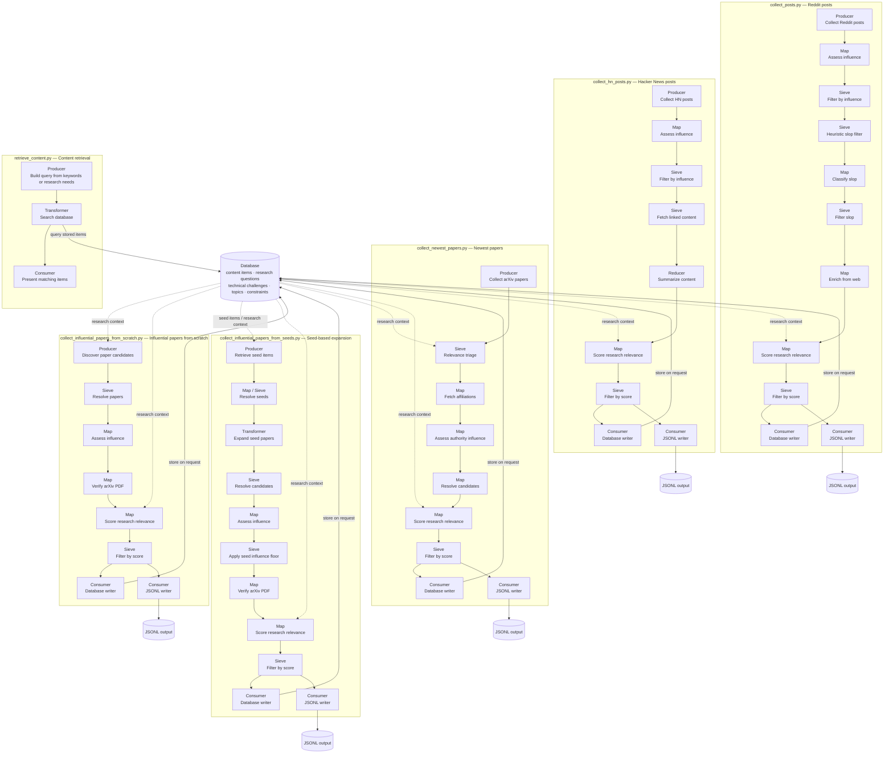
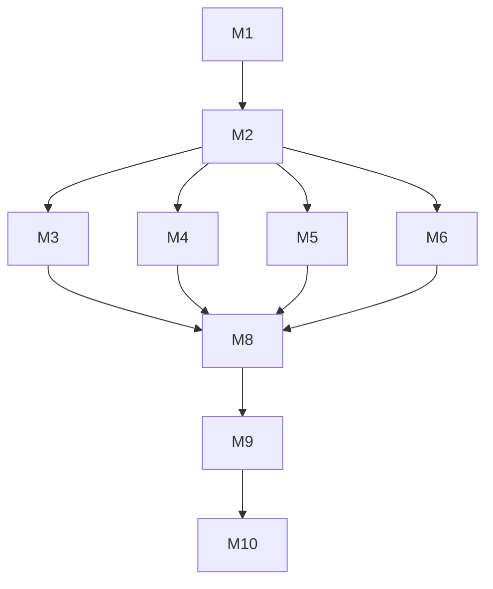

## mourat constitution spec

### 1. Executive summary

#### 1.1. Project description

`mourat` is a flexible set of tools helping a researcher to collect research-relevant information from two content types: papers and posts on the Internet. `mourat`'s input is research questions, technical challenges, research topics, and constraints. Using them, `mourat` should be able to find relevant content items in both retrospective (what are the most influential papers related to topic X?) and up-to-date (what are the most recent papers related to topic X?) modes. Its tools should be suitable for both human beings (just as runnable scripts) and AI agents (as tools).

#### 1.2. Project motivation

Information collection is necessary for many research workflows, but it takes time. `mourat` aims to reduce the manual effort required to collect research-relevant information.

#### 1.3. Implementation repos

The `anton-pershin/mourat` repository is both the management repo and the implementation repo.

#### 1.4. Architecture type

Pipeline architecture.

#### 1.5. Execution mode

Manual.

### 2. Requirement analysis

#### 2.1. Functional requirements

- **FR1:** Users can specify research questions, technical challenges, research topics, and constraints to describe their research needs. A research topic can be associated with one or more research questions or technical challenges. Constraints can refine those needs. These inputs are optional; if a user provides none, Mourat collects all content that the selected source can provide.

- **FR2:** Users can collect the newest papers for specified research needs.
- **FR3:** Users can collect influential papers and posts for specified research needs.
- **FR4:** Users can collect the newest posts from a specified web resource.
- **FR5:** A collection workflow can optionally assess content-item relevance to the specified research needs. It can retain content items whether or not they are relevant.
- **FR6:** Users can save collected content items to a database on request. Users can retrieve stored content items by keywords, research questions, technical challenges, constraints, and research topics.

#### 2.2. Non-functional requirements

None.

#### 2.3. Preferences

- **P1:** Process 2,000 raw content items in less than one hour.
- **P2:** Search 5,000 stored content items in less than one minute.
- **P3:** Use a lightweight, file-based database that people can inspect.
- **P4:** Make tools easy to use from the command line and from an AI agent harness.
- **P5:** Provide observability through loggers and monitoring handlers. At the debug and info levels, log enough detail to show progress through bulk content processing at short intervals.
- **P6:** Use the pipeline architecture. Define each filter’s input and output types with Pydantic.
- **P7:** Use Pydantic AI for LLM interaction.
- **P8:** Use Hydra for configuration.

### 3. Acceptance criteria

Automated tests verify the functional requirements. A human validates that the requirements are satisfied.

- **AC1 (FR1):** Verify that users can specify research questions, technical challenges, research topics, and constraints. Verify that the workflow can run when the user specifies none, and that a research topic can be associated with one or more research questions or technical challenges.
- **AC2 (FR2):** Verify that the newest-paper workflow collects papers from its configured source and applies the configured date range.
- **AC3 (FR3):** Verify that the influential-content workflow collects papers and posts for specified research needs.
- **AC4 (FR4):** Verify that the newest-post workflow collects posts from a specified web resource.
- **AC5 (FR5):** Verify that relevance assessment can be enabled or disabled, and that the workflow can retain both relevant and irrelevant content items.
- **AC6 (FR6):** Verify that users can save collected content items on request and retrieve them by keywords, research questions, technical challenges, constraints, and research topics.

### 4. Insight

No insight is needed.

### 5. Overall solution design

#### 5.1. High-level design

#### 5.2. Core components

- **Collection pipelines**
  - **`collect_newest_papers.py`** — orchestrator
    - Producer: collect newest papers.
    - Maps and sieves: triage relevance, fetch affiliations, assess authority influence, resolve candidates, score research relevance, and filter by score.
    - Consumers: database writer and JSONL writer.
  - **`collect_influential_papers_from_scratch.py`** — orchestrator
    - Producer: discover paper candidates.
    - Maps and sieves: resolve papers, assess influence, verify arXiv PDF, score research relevance, and filter by score.
    - Consumers: database writer and JSONL writer.
  - **`collect_influential_papers_from_seeds.py`** — orchestrator
    - Producer: retrieve seed items.
    - Transformers, maps, and sieves: resolve seeds, expand papers, resolve candidates, assess influence, apply the seed influence floor, verify arXiv PDF, score research relevance, and filter by score.
    - Consumers: database writer and JSONL writer.
  - **`collect_posts.py`** — orchestrator
    - Producer: collect Reddit posts.
    - Maps and sieves: assess and filter influence, filter slop, classify slop, enrich posts, score research relevance, and filter by score.
    - Consumers: database writer and JSONL writer.
  - **`collect_hn_posts.py`** — orchestrator
    - Producer: collect Hacker News posts.
    - Maps, sieves, and reducer: assess and filter influence, fetch linked content, summarize content, score research relevance, and filter by score.
    - Consumers: database writer and JSONL writer.
- **Content retrieval**
  - **`retrieve_content.py`** — orchestrator
    - Producer: build a query from keywords or research needs.
    - Transformer: search the database.
    - Consumer: present matching items.
- **Shared components**
  - **Database:** stores content items, research questions, technical challenges, research topics, and constraints. It supplies research context and supports retrieval.
  - **Pipes:** pass data in one direction between filters in each pipeline.
- **Auxiliary scripts**
  - `calibrate_hn_stats.py`
  - `calibrate_subreddit_stats.py`
  - `generate_queries.py`
  - `assess_candidate_topic.py`
  - Legacy: `collect_recent_influential_papers.py`
  - Deprecated: `print_reddit_summary.py`

### 6. Roadmap

#### 6.1. Milestones

Durations are estimates in weeks for one full-time person. Strong scaling efficiency is an estimate from 0 to 1; 1 means that adding people reduces the milestone duration in direct proportion to team size.

| ID | Name | Status | Expected result | Duration (weeks) | Strong scaling efficiency |
|----|------|--------|-----------------|------------------|---------------------------|
| M1 | Refactor existing scripts into modular components | Done | Collectors, scorers, filters, and database logic are separate configurable components. | 1 | 0.8 |
| M2 | Build content database layer | Done | A file-based database supports storage and retrieval by keywords, research questions, technical challenges, constraints, and topics. | 1 | 0.8 |
| M3 | Build `collect_posts` with enricher | Done | `collect_posts.py` collects and enriches posts. | 1 | 0.8 |
| M4 | Refactor `collect_recent_influential_papers` | Done | The influential-paper workflow supports web discovery, logging, and database interaction. | 3 | 0.8 |
| M5 | Refactor `collect_newest_papers` | To do | The newest-paper workflow supports deeper paper analysis, logging, and database interaction. | 4 | 0.8 |
| M6 | Build web resource autodiscovery | To do | A script discovers web resources, seeds content items, and outlines collectors for those resources. | 4 | 0.8 |
| M8 | Add benchmark tests | To do | Benchmarks measure collection of 2,000 items in less than one hour and retrieval over 5,000 items in less than one minute. | 1 | 0.8 |
| M9 | Add concurrent processing | To do | Independent LLM requests and data-collection requests run concurrently where appropriate. | 1 | 0.8 |
| M10 | Implement tool registry | To do | A tool registry maps typed agent calls to configured modules. | 1 | 0.8 |

