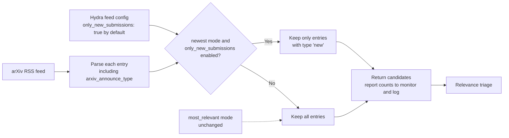

## Filter arXiv announcements to new submissions

### 1. Requirement analysis

**R1.** The newest-paper collection pipeline shall provide a configurable option to include only new arXiv submissions. The option shall be enabled by default.

**B1.** When enabled, keep a feed item only when its announce type is exactly `new`. Exclude `cross`, `replace`, `replace-cross`, missing values, and unrecognized values.

**B2.** When disabled, keep all feed items, including items with missing or unrecognized announce types. This preserves the current behavior when the user opts out.

**R2.** Apply the filter after collection and before relevance triage or any later per-paper processing. When enabled, report the number of excluded papers in both the monitoring-handler output and the application log. Report the collected, kept, and excluded counts.

**R3.** Read the structured announce-type field from each feed item and preserve the parsed value on the candidate for monitoring.

**R4.** Apply this option only in `newest` mode. Do not change `most_relevant` mode.

### 2. Tests

**T1.** Verify that the RSS parser reads the structured `arxiv_announce_type` field and stores its value on the candidate. Cover `new`, `replace`, `cross`, and `replace-cross`.

**T2.** With the filter enabled by default, verify that only candidates marked `new` continue to relevance triage. Verify that `replace`, `cross`, `replace-cross`, missing, and unknown values do not continue.

**T3.** With the filter disabled, verify that all candidates continue, including those with missing or unknown announce types.

**T4.** Verify that the monitoring-handler output and application log both report the collected, kept, and excluded counts, including the number filtered by the new-only rule.

**T5.** Verify that `most_relevant` mode is unchanged by this option.

### 3. Implementation plan

#### 3.1 Implementation repos

| Repo | Role |
|------|------|
| `/home/tony/reps/github/anton-pershin/mourat` | Management and implementation repo. Contains the arXiv collector, newest-paper pipeline, Hydra config, and tests. |

#### 3.2 High-level design

#### 3.3 Todo list

1. [x] Add tests in `tests/test_collectors.py` and `tests/test_newest_paper_script.py` for structured announce-type parsing, filtering, counts, configuration, and pipeline wiring.
2. [x] Run the focused tests and confirm that they fail before implementation.
3. [x] Set `only_new_submissions: true` in each newest-mode feed configuration.
4. [x] Read `arxiv_announce_type` and store it on each `PaperCandidate`. Use description parsing as a fallback if the structured field is absent.
5. [x] When enabled, keep only candidates with type exactly `new`. When disabled, keep all candidates. Do not apply this option in `most_relevant` mode.
6. [x] Include collected, kept, and excluded counts, including how many papers the rule filtered, in both monitoring-handler output and the application log.
7. [x] Run the focused tests, full test suite, and project linters.

#### 3.4 Modification summary

| File | Action |
|------|--------|
| `mourat/collectors/arxiv.py` | Modify: parse the structured announce-type field, apply the configurable `new`-only filter in `newest` mode, and report collected, kept, and excluded counts in monitoring output and the application log. |
| `mourat/data_models.py` | Modify: document the structured announce-type values stored on candidates. |
| `config/config_collect_newest_papers.yaml` | Modify: enable `only_new_submissions` by default for the configured feed. |
| `config/collector/arxiv_rss_cs_lg.yaml` | Modify: enable `only_new_submissions` by default for the RSS collector config. |
| `tests/test_collectors.py` | Modify: test structured field parsing, filter behavior, monitoring counts, and unchanged `most_relevant` behavior. |
| `tests/test_newest_paper_script.py` | Modify: add structured `new` announce types to feed fixtures so pipeline-wiring tests exercise the default filter. |