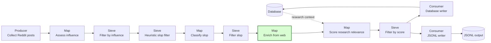
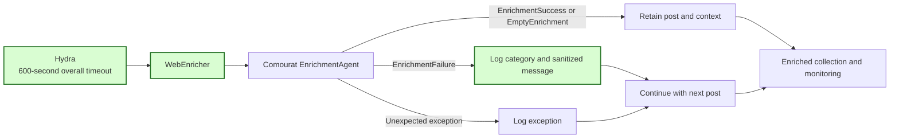

## Explicit Comourat enrichment outcomes

This spec implements GitHub issue #18. It adapts Mourat to the enrichment result contract merged in Comourat PR #12 at commit `3ca8190f0907ed7515bebcf14f006494d5fa0a48`.

### 1. Requirement analysis

- **R1 — Preserve successful enrichment.** `WebEnricher` must retain a post when Comourat returns `EnrichmentSuccess` or `EmptyEnrichment`. It must copy the returned `additional_context` list and preserve the current monitoring output.
- **R2 — Isolate returned failures.** Immediately after `EnrichmentAgent.enrich` returns, `WebEnricher` must detect `EnrichmentFailure`. It must log the post identifier, `error_category`, and sanitized `error_message`, then skip only that post. It must not access `additional_context` on a failure or convert a failure into an empty success.
- **R3 — Isolate unexpected exceptions.** The existing exception handler must remain. An unexpected exception from the adapter must log the exception and skip only the affected post.
- **R4 — Expose the complete-run deadline.** `WebEnricher` must accept `overall_timeout: float = 120.0` and forward it to `EnrichmentAgent` with and without a proxy. The Reddit Hydra configuration must set it explicitly to 600 seconds. This value exceeds the existing 300-second model timeout and leaves budget for web tools, retries, and output processing in the same complete-run deadline. The configuration and README must explain this relationship.
- **R5 — Select compatible dependencies.** Package metadata and runtime requirements must require `pydantic-ai >= 2.64.0`. Development requirements must state the same minimum for enrichment tests. Package metadata and runtime requirements must select Comourat by the full reviewed commit `3ca8190f0907ed7515bebcf14f006494d5fa0a48`, not by moving `main`. The README must explain that a reviewer must inspect a new Comourat contract and run the tests before updating this commit.
- **R6 — Verify the merged contract.** Tests and static checks must run with the reviewed Comourat commit and `pydantic-ai` 2.64.0 or later. Tests must not need live provider or web access.

Expected behavior variants:

- **B1 — Context result.** A post with one or more context points remains in the output with those points.
- **B2 — Successful no-context result.** A post with an empty context list remains in the output.
- **B3 — Returned failure.** Search, fetch, provider, usage-limit, and timeout failures each omit only the failed post. A later post is still processed and retained when it succeeds. The log contains the fixed category and sanitized message.
- **B4 — Unexpected exception.** An exception skips only the affected post and uses the existing exception log path.
- **B5 — Constructor configuration.** A caller-supplied overall timeout reaches both Comourat constructor branches. A direct caller that omits it keeps Comourat's 120-second default.
- **B6 — Fresh installation.** Runtime and development dependency declarations cannot select `pydantic-ai` older than 2.64.0. Runtime installation selects the reviewed Comourat revision explicitly.

Edge cases:

- A failure between two successful posts must not prevent monitoring or output for either successful post.
- A failed post must not appear in the enrichment monitoring text.
- Failure logging must use only Comourat's public category and sanitized message. It must not reconstruct or expose provider exception details.
- The 600-second setting is an upper bound for the complete enrichment run. It does not increase the separate 300-second model-request timeout.

### 2. Tests

- **T1 — Successful outcomes.** Keep the existing context, no-context, and monitoring tests. Run them with the merged Comourat result types. Covers R1, B1, and B2.
- **T2 — Every returned failure category.** Parameterize search, fetch, provider, usage-limit, and timeout results. Return a failure for the first post and a context success for the second. Assert that only the second post remains, both calls occur, the failed post is absent from monitoring, and the log contains the category and sanitized message. Covers R2 and B3.
- **T3 — Unexpected adapter exception.** Script an exception followed by a successful result. Assert that the later post remains and the existing exception logger runs. Covers R3 and B4.
- **T4 — Timeout forwarding and Hydra composition.** Assert the default and a custom overall timeout in the proxy and no-proxy constructor branches. Compose `config_collect_posts` and assert that the enricher receives 600 seconds. Covers R4 and B5.
- **T5 — Dependency declarations.** Inspect `pyproject.toml`, `requirements.txt`, and `requirements_dev.txt`. Assert the `pydantic-ai` minimum and the full Comourat commit. Covers R5 and B6.
- **T6 — Complete verification.** Run the full pytest suite, Black, isort, pylint, and mypy with the reviewed Comourat commit and `pydantic-ai` 2.64.0. Covers R6 and all variants.

### 3. Implementation plan

#### 3.1 Implementation repos

- `anton-pershin/mourat`: management repository and only implementation repository. The required Comourat implementation is already merged and is a pinned dependency.

#### 3.2 High-level design

The first diagram copies the Reddit pipeline from the constitution and marks the modified enrichment stage in green.

The second diagram shows the outcome boundary inside `WebEnricher` and the explicit configuration flow.

`WebEnricher` narrows the Comourat union with `isinstance(result, EnrichmentFailure)` before either `additional_context` access. The two successful result types retain their common field. No new result model or exception type is needed in Mourat.

#### 3.3 Todo list

1. [x] Write the outcome, timeout, configuration, and dependency tests.
2. [x] Run the focused tests and confirm the expected failures with merged Comourat.
3. [x] Handle returned failures before successful-result processing.
4. [x] Forward the overall timeout and configure the 600-second Reddit value.
5. [x] Set dependency minimums, pin reviewed Comourat, and document both choices.
6. [x] Run the focused tests, full suite, formatting checks, pylint, and mypy.
7. [x] Commit and push the assigned branch, then open one pull request for issue #18.

#### 3.4 Modification summary

| File | Action |
|------|--------|
| `.internal/specs/18-explicit-enrichment-outcomes-kiss-spec.md` | New: requirements, design, edge cases, and test plan |
| `mourat/enrichers/web_enricher.py` | Modified: handle explicit failures and forward the overall timeout |
| `config/config_collect_posts.yaml` | Modified: expose and explain the 600-second overall timeout |
| `pyproject.toml` | Modified: require compatible `pydantic-ai` and pin reviewed Comourat |
| `requirements.txt` | Modified: require compatible `pydantic-ai` and pin reviewed Comourat |
| `requirements_dev.txt` | Modified: state the `pydantic-ai` minimum for development tests |
| `README.md` | Modified: document timeout and reviewed Comourat revision selection |
| `tests/test_enrichers.py` | Modified: cover failures, continuation, timeout forwarding, and dependency declarations |
| `tests/test_hn_config.py` | Modified: verify Hydra overall-timeout composition |
