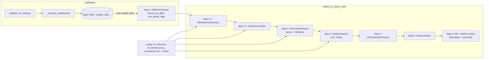

## HN post collection

### 1. Requirement analysis

**Background.** The post collection pipeline covers Reddit only. We add a parallel HackerNews (HN) collection pipeline that discovers influential HN stories, fetches and summarizes the story content, and scores it for relevance to the project's research questions / technical challenges / topics / constraints. The Reddit pipeline remains untouched; HN gets its own Pydantic models, processors, writers, config, and script.

**Data source.** The HN Algolia Search API (`https://hn.algolia.com/api/v1/search_by_date`), no authentication. Collection uses date-ordered search with server-side numeric filters (`created_at_i` window, `points >= min_points`) and tag filters from config (`story`, `ask_hn`, `show_hn` are supported). No query-driven text search — the feed is topic-agnostic; relevance is decided downstream by the LLM scorer. Pagination is handled by the collector; a single query returns at most 1000 hits (10 pages × 100).

**Pipeline order** (new script `collect_hn_posts.py`, mirroring `collect_posts.py`):

```
1. HNPostCollector            collect stories from Algolia (min_points, window, tags)
1.5 HNInfluenceAssessor       compute_influence_score(points, reference)  -> influence_score
1.6 HNInfluenceFilter         drop posts with influence_score < min_influence
2. HNContentFetcher           fetch post.url via proxy, extract main content (trafilatura);
                              a post whose URL is unavailable is DROPPED
3. HNSummarizer (LLM)         produce compact description from fetched content;
                              full fetched text is discarded after summarization
4. HNContentItemScorer        relevance scoring; sees title + description only
5. HNScoreFilter              filter by relevance score
6. Writers                    DB writer (platform_id="hackernews",
                              influence_metric_id="hn_points", item id hn_{objectID},
                              description = summary) + JSONL writer
```

**Requirements.**

- **R1 (models).** New `HNPostInfo` and `HNPostCollection` in `mourat/data_models.py`, plus `SummarizedHNPost(Collection)` and `ScoredHNPost(Collection)` following the Reddit naming pattern. Fields on `HNPostInfo`: `hn_id: str`, `title: str`, `author: str`, `date: str` (ISO), `url: str`, `text: str = ""` (story_text when present, else empty), `points: int`, `num_comments: int`, `influence_score: int | None = None`, `description: str = ""` (filled by the summarizer).

- **R2 (HN API client).** New `mourat/clients/hn_algolia.py`: `HNAlgoliaClient` wrapping `search_by_date` requests (no auth). Inputs: time window bounds, `min_points`, tags, page size. Returns parsed hits as `HNPostInfo`-shaped dicts. Server-side numeric filters are part of the query string. Request errors and malformed responses raise (loud failure); no silent fallback.

- **R3 (collector).** `HNPostCollector(Function[Any, HNPostCollection])` in `mourat/collectors/hn.py`: iterates all pages of the windowed query, builds `HNPostCollection`. Config keys: `time_window`, `min_points: int` (server-side; the value is set by the user after calibration output exists — no fixed default in this spec), `tags: list[str]` (default `[story]`; ask_hn/show_hn are disjoint subsets of story), `limit: int` (max hits fetched, default 1000).

- **R4 (influence).** `HNInfluenceAssessor` and `HNInfluenceFilter` in `mourat/processors/hn_influence.py`, typed on `HNPostCollection`. The assessor computes `compute_influence_score(post.points, reference_level)` (the existing neutral function from spec 17, reused as-is) and writes `influence_score` onto the post. The filter drops posts with `influence_score < min_influence`, with drop-accounting logging consistent with the other filters. Config group `hn_influence` with `reference_level: float` (a single global HN reference — no per-community mapping) and `min_influence: int` (default 50). A non-positive `reference_level` raises a ValueError naming the value (loud failure; the `max(reference, 1)` guard from spec 17 is NOT replicated — a misconfigured 0/negative reference is a config error).

- **R5 (calibration script).** `mourat/scripts/calibrate_hn_stats.py` with `config/config_calibrate_hn_stats.yaml`. Same output style as the Reddit calibration script: computes `median`, `n`, `mean`, `p10`, `p90`, `max` (plus optional extra `percentiles`, both scales accepted) over story `points`, writes a YAML block with timestamp header, `mode: overwrite|append`, `min_sample` guard with `insufficient: true`. Differences from Reddit: data comes from `search_by_date` with `created_at_i` range [now−48h, now−24h] (yesterday's cohort — HN points saturate within ~24 h, so scores in this window are final); sample limit and tags from config; no subreddit dimension — one aggregate over all HN stories (optionally restricted by tags from config). The user copies the chosen percentile value into `hn_influence.reference_level` by hand.

- **R6 (content fetching).** `HNContentFetcher(Function[HNPostCollection, HNPostCollection])` in `mourat/processors/hn_fetcher.py`: for each post, fetch `post.url` through the configured proxy, extract main content with trafilatura (same extractor as the `extract_url` tool). Proxy is read from config like the Semantic Scholar client (env-var pattern, key `HN_FETCH_PROXY`). A post whose URL cannot be fetched (HTTP error, timeout, connection error) is dropped from the collection; a post whose extracted content is empty or None is also dropped. Per-post failures are logged at debug level; a summary count (dropped/kept) appears in the monitoring text.

- **R7 (summarizer).** `HNSummarizer(Function[HNPostCollection, HNPostCollection])` in `mourat/processors/hn_summarizer.py`: one LLM call per post; input is `title + fetched content`; output parsed to a compact description string stored on the post (`description`). The fetched content is used only inside this stage and is not retained on the model. Unparseable LLM output is retried up to a configurable number of times (`retries` config key); after retries are exhausted the post is dropped with a logged warning (no empty description reaches the scorer or the DB). LLM is instantiated from config following the existing `llm` group pattern.

- **R8 (scoring).** `HNContentItemScorer` in `mourat/processors/content_item_scorer.py` (same file as the Reddit binding): a thin domain binding of the neutral `ContentItemScorer`, analogous to `PostContentItemScorer`. The item text presented to the LLM is `title + "\n\n" + description` (summary only — the full fetched text was discarded in R7). Constraints are excluded for HN posts, same as for Reddit posts. Output type `ScoredHNPost` carries `influence_score` through from the underlying `HNPostInfo`.

- **R9 (score filter + writers).** `HNScoreFilter` mirrors `PostScoreFilter` semantics (threshold in raw relevance units, config-driven). The DB writer `HNContentItemDbWriter` mirrors `PostContentItemDbWriter`: dedup by `hn_{objectID}`, ensure reference rows (`platform_id="hackernews"`, `influence_metric_id="hn_points"`), `description = post.description`, `influence_score` stored as computed (fallback `min(100, post.points)` only when `influence_score is None`, i.e. influence disabled). A JSONL writer mirrors `PostJsonlWriter` (record contains hn_id, points, influence_score, description).

- **R10 (script + config).** `mourat/scripts/collect_hn_posts.py` with `config/config_collect_hn_posts.yaml`: procedural main like `collect_posts_main`, steps numbered as above, `_log_post_counts`-style step logging, `read_enabled` guards for the influence group and both writers, `db_path` required and must exist. No Reddit credentials needed; no user_settings keys beyond an optional proxy.

**Expected variants.**

- **B1.** `hn_influence.enabled: false` → no assess/filter steps; writer fallback `min(100, post.points)` applies.
- **B2.** `hn_influence.enabled: true` → steps 1.5/1.6 run; a post at the reference level scores 50 and survives the default filter.
- **B3.** `reference_level <= 0` → ValueError naming the value; run fails before any network or LLM work.
- **B4.** A post URL fails to fetch, times out, or yields no extractable content → that post is dropped at step 2; other posts proceed.
- **B5.** A page of results is empty before `limit` is reached → collection ends cleanly with the posts gathered so far (normal end-of-results, not an error).
- **B6.** Summarization LLM returns unparseable output for a post → retried up to the configured number of times, then the post is dropped with a logged warning.

**Note.** The influence-score formula is an implementation detail of the assessor (see spec 17's note); the pipeline structure (stage order, config groups, writer behavior) is the stable contract.

### 2. Tests

New test files: `tests/test_hn_pipeline.py` (collector, influence, fetcher, summarizer, scorer binding), `tests/test_hn_clients.py` (Algolia client, mocked HTTP), `tests/test_calibrate_hn_stats.py` (calibration), plus extensions to writer/config tests. No live network in any test.

**Collector & client**

- **T1 (R2).** `HNAlgoliaClient` with mocked HTTP: request URL carries the numeric filter string `created_at_i>{lo},created_at_i<{hi},points>={min_points}` and tags; parses hit dicts into `HNPostInfo`-shaped dicts with all fields (points, num_comments, objectID→hn_id, created_at_i→ISO date, title, url, story_text or "").
- **T2 (R2).** HTTP error / non-JSON response / missing `hits` key → exception raised (loud failure, no empty-result fallback).
- **T3 (R3, B5).** Pagination: three mocked pages then an empty page → collector returns all posts and stops cleanly; the `limit` cap truncates earlier when hit.
- **T4 (R3).** Hits missing `story_text` → `text=""`; `points`/`num_comments` always mapped.

**Influence**

- **T5 (R4, B2).** Assessor with reference R: points = R → 50; 0 → 0; 9R → 90; rounding verified on a non-integer ratio case. Other fields unchanged.
- **T6 (R4, B3).** `reference_level <= 0` → ValueError naming the value.
- **T7 (R4, B1).** Filter with `min_influence=50`: posts at 49/50/51 → 49 dropped, drop count logged; collection type preserved.

**Calibration script**

- **T8 (R5).** `_compute_stats` on known points: median/p10/p90/max match independent computation; extra percentiles emitted nearest-rank; insufficient sample → `insufficient: true`, no median.
- **T9 (R5).** Window selection: `_collect_scores` built over a stub Algolia client — posts inside [now−48h, now−24h] counted, outside excluded; the range is a bounded window (not "newest N").
- **T10 (R5).** `overwrite`/`append` YAML behavior: identical to spec 16's T4–T6 semantics (single timestamped block; appended block after old).
- **T11 (R5).** Config composes; exposes window bounds, sample_limit, min_sample, percentiles, output_path, mode, tags with defaults.

**Fetcher**

- **T12 (R6, B4).** Stub HTTP: 200 + extractable HTML → content extracted; 404/timeout/connection error → post dropped; extracted content empty/None → post dropped; remaining posts unaffected; summary count in monitoring text.
- **T13 (R6).** Proxy: configured proxy is passed to the HTTP session (assert the session's proxies dict, mirroring the Semantic Scholar client's proxy mechanism).

**Summarizer**

- **T14 (R7, B6).** Stub LLM: valid output → `description` set, fetched text NOT present on the post model; parse failure → retried `retries` times then post dropped with warning; success on retry N honored.
- **T15 (R7).** Stub LLM receives exactly `title + description-source content` in its prompt (no other fields).

**Scoring & writers**

- **T16 (R8).** `HNContentItemScorer`: scored item text is `title + "\n\n" + description` (summary only); constraints excluded; `influence_score` carried from `HNPostInfo` onto `ScoredHNPost`.
- **T17 (R9, B1).** DB writer: dedup by `hn_{id}` (second write skipped, counted); reference rows created (platform "hackernews", metric "hn_points"); `description` = summary; `influence_score=73` stored as 73; `None` → `min(100, points)`.
- **T18 (R9).** JSONL writer: record contains hn_id, points, influence_score, description.
- **T19 (R10).** `config_collect_hn_posts.yaml` composes; superset-only additions; `read_enabled` guards present for influence group and both writers.

### 3. Implementation plan

#### 3.1 Implementation repos

- `anton-pershin/mourat` (management and implementation repo, degenerate case).

#### 3.2 High-level design



Components:
- `mourat/clients/hn_algolia.py` — `HNAlgoliaClient`: builds `search_by_date` requests with numeric filters and tags; parses hits; loud failures.
- `mourat/collectors/hn.py` — `HNPostCollector(Function[Any, HNPostCollection])`: paginates the client, respects `limit`.
- `mourat/processors/hn_influence.py` — `HNInfluenceAssessor` / `HNInfluenceFilter`; reuses `compute_influence_score` from `mourat/processors/post_influence.py`.
- `mourat/processors/hn_fetcher.py` — `HNContentFetcher`: proxy-aware requests session + trafilatura; drops failed/empty posts.
- `mourat/processors/hn_summarizer.py` — `HNSummarizer`: LLM call per post, configurable retries, drop after exhaustion; sets `description`.
- `mourat/processors/content_item_scorer.py` — add `HNContentItemScorer` binding; `ScoredHNPost` output.
- `mourat/writers/hn_post_writers.py` — `HNContentItemDbWriter` (platform "hackernews", metric "hn_points", id `hn_{id}`, description = summary) + `HNPostJsonlWriter`.
- `mourat/scripts/collect_hn_posts.py` + `config/config_collect_hn_posts.yaml` — procedural pipeline, step ids 1, 1.5, 1.6, 2–6; `read_enabled` guards.
- `mourat/scripts/calibrate_hn_stats.py` + `config/config_calibrate_hn_stats.yaml` — yesterday's-cohort [now−48h, now−24h] sampling over `search_by_date`.
- Data models: `HNPostInfo`, `HNPostCollection`, `SummarizedHNPost(Collection)`, `ScoredHNPost(Collection)` in `mourat/data_models.py`.

#### 3.3 Todo list

1. [x] Write the tests (T1–T19: new `tests/test_hn_clients.py`, `tests/test_hn_pipeline.py`, `tests/test_hn_writers.py`, `tests/test_hn_config.py`, `tests/test_calibrate_hn_stats.py`)
2. [x] Run all the tests and ensure that they fail
3. [x] Add HN data models to `mourat/data_models.py`
4. [x] Implement `HNAlgoliaClient` (client + tags + numeric filters + pagination + parse)
5. [x] Implement `HNPostCollector`
6. [x] Implement `HNInfluenceAssessor` and `HNInfluenceFilter` (reuse `compute_influence_score`)
7. [x] Implement `calibrate_hn_stats.py` + its config
8. [x] Implement `HNContentFetcher` (proxy + trafilatura + drop semantics)
9. [x] Implement `HNSummarizer` (LLM, retries, drop after exhaustion)
10. [x] Add `HNContentItemScorer` binding + `ScoredHNPost` travel
11. [x] Implement `HNScoreFilter` and both writers
12. [x] Implement `collect_hn_posts.py` + `config_collect_hn_posts.yaml`
13. [x] Run all the tests and ensure that they pass
14. [x] Run black on touched files and the full test suite to confirm no regressions

#### 3.4 Modification summary

| File | Action |
|------|--------|
| `mourat/data_models.py` | Add HN models |
| `mourat/clients/hn_algolia.py` | New |
| `mourat/collectors/hn.py` | New |
| `mourat/processors/hn_influence.py` | New |
| `mourat/processors/hn_fetcher.py` | New |
| `mourat/processors/hn_summarizer.py` | New |
| `mourat/processors/content_item_scorer.py` | Add `HNContentItemScorer` binding |
| `mourat/filters.py` | Add `HNScoreFilter` |
| `mourat/writers/hn_post_writers.py` | New |
| `mourat/scripts/collect_hn_posts.py` | New |
| `mourat/scripts/calibrate_hn_stats.py` | New |
| `config/config_collect_hn_posts.yaml` | New |
| `config/config_calibrate_hn_stats.yaml` | New |
| `tests/test_hn_clients.py` | New |
| `tests/test_hn_pipeline.py` | New |
| `tests/test_hn_writers.py` | New |
| `tests/test_hn_config.py` | New |
| `tests/test_calibrate_hn_stats.py` | New |

Reddit pipeline files are NOT modified: the neutral `compute_influence_score` and the neutral scorer core are imported, not changed; all Reddit-typed classes are cloned into HN siblings rather than generalized.
