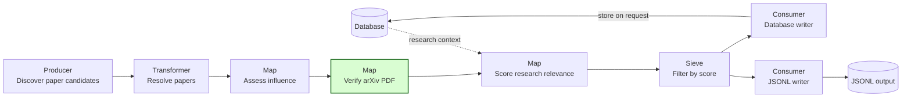
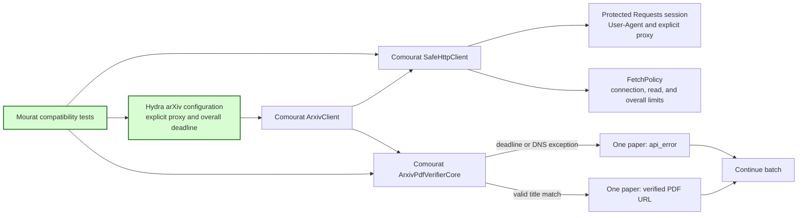

## arXiv deadline transport compatibility

This spec implements GitHub issue #20. It adapts Mourat to the arXiv operation deadline merged in Comourat PR #17 at commit `f15a0375889464d44f8ca93991fc32dd9b43a2a5`.

### 1. Requirement analysis

- **R1 — Current protected-transport checks.** The two arXiv default-session tests must verify the configured User-Agent and proxy through `ArxivClient._safe_client.session`. They must not use the removed `ArxivClient._session` attribute. The tests must confirm that the default transport is Comourat `SafeHttpClient`.
- **R2 — Existing arXiv behavior.** Existing injected-client, retry, title-lookup, title-search, and PDF-verification tests must retain their behavior. Mourat must not add a replacement HTTP fetch implementation or change the `ArxivPdfVerifier` adapter contract.
- **R3 — Reviewed dependency selection.** `pyproject.toml` and `requirements.txt` must select Comourat commit `f15a0375889464d44f8ca93991fc32dd9b43a2a5`. This revision advances the revision selected by issues #18 and #19 and retains their enrichment and article contracts. Dependency tests and the README must select the same revision.
- **R4 — Explicit deployment configuration.** The arXiv Hydra configuration must keep `proxy: ${oc.env:ARXIV_PROXY,null}` and set `overall_timeout_seconds: 120.0` explicitly. The existing `timeout_seconds: 120.0` setting must remain. Both influential-paper pipelines must compose these values. The README must state that generic `HTTP_PROXY` and `HTTPS_PROXY` variables do not configure the protected arXiv transport. It must explain that the overall deadline includes DNS, connection setup, TLS, redirects, response transfer, retries, delays, and response parsing.
- **R5 — Per-paper failure containment.** Comourat `FetchDeadlineExceeded` and `FetchResolutionError` exceptions must produce `api_error` for the affected paper. Verification must continue with later papers and retain the existing monitoring counts. Mourat must use the existing Comourat verification core for this behavior.
- **R6 — Selected-revision verification.** Focused arXiv tests, the complete Mourat suite, and quality checks must run against the selected Comourat revision. Tests must use controlled doubles and must not require live provider access.

Expected behavior variants:

- **B1 — Direct access.** The default protected transport has no explicit proxy. Generic environment proxy variables do not supply one implicitly.
- **B2 — Explicit proxy.** `ARXIV_PROXY` reaches the protected session as both the HTTP and HTTPS proxy.
- **B3 — Bounded operation.** The configured connection, read, and overall limits reach the Comourat fetch policy. The overall limit does not restart for retries or response progress.
- **B4 — Provider failure.** A deadline or DNS failure leaves one paper URL empty with reason `api_error`. A later paper can still receive a verified PDF URL.
- **B5 — Fresh installation.** Runtime dependency declarations select the revision that contains the deadline transport and the previously reviewed enrichment and article contracts.

### 2. Tests

- **T1 (R1, R2, B2) — Protected session configuration.** Update the two default-session tests. Assert that the default client contains `SafeHttpClient`, its session has the configured User-Agent, and an explicit proxy configures both HTTP and HTTPS entries. Run the existing mocked arXiv client tests.
- **T2 (R4, B1, B3) — Deadline and environment-proxy policy.** Construct the default client with controlled timeout values. Assert the overall, connection, and read values in its fetch policy. Set generic environment proxy variables without an explicit arXiv proxy and assert that the protected session has no proxies and has `trust_env` disabled.
- **T3 (R4, B2, B3) — Hydra composition.** Compose both influential-paper configurations with `ARXIV_PROXY` and generic proxy variables set. Assert that each arXiv client configuration selects `ARXIV_PROXY`, 120-second connection and read limits, and a 120-second overall deadline. Compose without `ARXIV_PROXY` and assert a null proxy even when generic variables are set.
- **T4 (R5, B4) — Deadline and DNS containment.** Parameterize Comourat deadline and DNS exceptions. Return each exception for the first paper and a valid title match for the second. Assert `api_error` for the first paper, a verified URL for the second, both client calls, and monitoring counts for one verified paper and one absent URL.
- **T5 (R2, R5) — Existing verifier behavior.** Run all PDF-verifier tests without changing the adapter or its public constructor.
- **T6 (R3, B5) — Dependency declarations.** Update the existing dependency assertions and run them for package metadata and runtime requirements.
- **T7 (R6) — Regression and quality checks.** Run the focused arXiv tests, complete pytest suite, Black, isort, pylint, and mypy against the selected Comourat revision without live provider access.

### 3. Implementation plan

#### 3.1 Implementation repos

- `anton-pershin/mourat`: management repository and only implementation repository.
- `anton-pershin/comourat`: read-only dependency at commit `f15a0375889464d44f8ca93991fc32dd9b43a2a5`. No change is required.

#### 3.2 High-level design

The first diagram copies the influential-paper pipeline from the constitution and marks the verification stage whose configuration and tests change in green. The seed-based pipeline uses the same verifier configuration.

The second diagram shows the existing Comourat boundary and the changed configuration and tests. Green nodes receive changes in this spec.

Mourat production Python code remains unchanged. Comourat owns network controls and per-paper exception conversion. Mourat tests inspect the current protected-transport boundary and its public outcome mapping.

#### 3.3 Todo list

1. [ ] Write the protected-transport, Hydra, failure-containment, and dependency tests.
2. [ ] Run the focused tests against the selected Comourat revision and confirm the expected failures.
3. [ ] Update the two default-session tests without changing their configured values.
4. [ ] Configure and document the explicit overall deadline and proxy behavior.
5. [ ] Advance the reviewed Comourat revision and its dependency assertions.
6. [ ] Run the focused tests, complete suite, formatting checks, pylint, and mypy.
7. [ ] Commit and push the assigned branch, then open one pull request for issue #20.

#### 3.4 Modification summary

| File | Action |
|------|--------|
| `.internal/specs/20-arxiv-deadline-transport-kiss-spec.md` | New: requirements, tests, and implementation plan |
| `tests/test_clients.py` | Modified: inspect the protected session and verify deadline and environment-proxy policy |
| `tests/test_arxiv_config.py` | New: verify both Hydra configurations and explicit proxy selection |
| `tests/test_arxiv_pdf_verifier.py` | Modified: cover Comourat deadline and DNS exceptions with batch continuation |
| `config/arxiv_pdf_verifier/default.yaml` | Modified: configure and explain the overall operation deadline |
| `pyproject.toml` | Modified: select the reviewed Comourat deadline revision |
| `requirements.txt` | Modified: keep runtime installation on the same reviewed revision |
| `README.md` | Modified: document the selected revision, explicit proxy, deadline scope, and per-paper failures |
| `tests/test_enrichers.py` | Modified: advance the inherited Comourat dependency assertion |
| `tests/test_hn_config.py` | Modified: advance the inherited Comourat dependency assertion |
