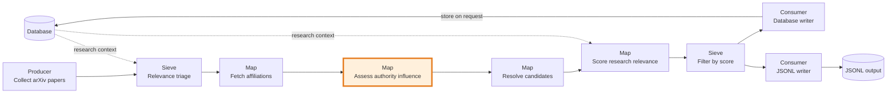
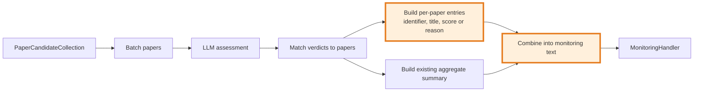

## Authority assessment monitoring

### 1. Requirement analysis

**R1.** For each paper assessed by `AuthorityInfluenceAssessor`, send the monitoring handler the paper's stable identifier, title, and either its influence score or an `unassessable` status with a reason. A score of `0` is a score, not an unassessable result. Keep the existing aggregate summary.

**B1.** The paper has a score, including a score of `0`.

**B2.** No score is available because a verdict is missing or batch retries are exhausted; report `unassessable` with the reason.

### 2. Tests

**T1 (R1, B1).** A paper with an arXiv ID receives a valid score of `0`. Assert that monitoring includes its identifier, title, and `score: 0`.

**T2 (R1, B2).** A paper with a DOI has no verdict. Assert that monitoring includes its identifier, title, and `unassessable` with a reason.

**T3 (R1, B2).** The batch request exhausts its retries. Assert that monitoring reports each affected paper as `unassessable` with a reason. *(Not yet covered by a dedicated monitoring test.)*

**T4 (R1).** Assert that the per-paper entries do not remove or change the existing aggregate summary.

### 3. Implementation plan

#### 3.1 Implementation repos

- `mourat` — all implementation and tests.

#### 3.2 High-level design

The first diagram shows the `collect_newest_papers.py` pipeline. The highlighted component is modified by this spec. The remaining stages and their relationships remain unchanged.

The component diagram shows the assessor's per-paper output alongside the existing aggregate summary.

#### 3.3 Todo list

1. [x] Add a regression test for a valid zero score and a missing verdict.
2. [x] Run the focused test before implementation and confirm it fails because per-paper monitoring is missing.
3. [x] Add per-paper identifier, title, score, or unassessable reason to the monitoring output.
4. [x] Keep the existing aggregate summary in the implementation.
5. [x] Run the focused test, full test suite, formatter, and linter.
6. [ ] Add a monitoring test for exhausted batch retries (T3).
7. [ ] Add an assertion that the aggregate summary remains in the monitoring output (T4).

#### 3.4 Modification summary

| File | Action |
|------|--------|
| `mourat/processors/authority_influence.py` | Modified: add per-paper assessment entries to monitoring output while retaining aggregate summary. |
| `tests/test_newest_paper_pipeline.py` | Modified: test monitoring with a zero score and an unassessable paper. |
