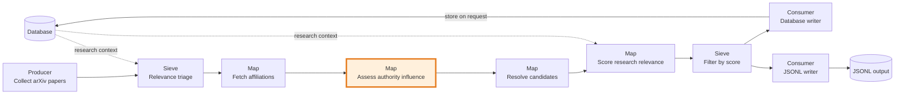
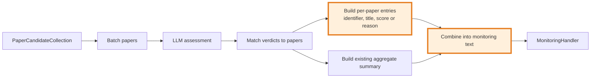

## Authority assessment monitoring

### 1. Requirement analysis

**R1.** For each paper assessed by `AuthorityInfluenceAssessor`, send the monitoring handler the paper's stable identifier, title, and either its influence score or an `unassessable` status with a reason. A score of `0` is a score, not an unassessable result. Keep the existing aggregate summary.

**B1.** The paper has a score, including a score of `0`.

**B2.** No score is available because a verdict is missing or batch retries are exhausted; report `unassessable` with the reason.

### 2. Tests

**T1 (R1, B1).** A paper with an arXiv ID receives a valid score of `0`. Assert that monitoring includes its identifier, title, and `score: 0`.

**T2 (R1, B2).** The first response omits one paper, and its follow-up response also omits that paper. Assert that its per-paper entry reports `unassessable: missing verdict` and that it does not report a retry-failure reason.

**T3 (R1, B2).** The batch request exhausts its retries. Assert that each affected paper has a distinct `unassessable` entry with a batch-retry failure reason.

**T4 (R1).** Assert that the per-paper entries do not remove or change the existing aggregate summary.

**T5 (R1).** Papers without an arXiv ID, DOI, or URL receive a stable content-derived identifier. Assert that equal titles with different authors receive distinct identifiers and repeated runs produce the same identifiers.

### 3. Implementation plan

#### 3.1 Implementation repos

- `mourat` — all implementation and tests.

#### 3.2 High-level design

The first diagram shows the `collect_newest_papers.py` pipeline. The highlighted component is modified by this spec. The remaining stages and their relationships remain unchanged.

The component diagram shows the assessor's per-paper output alongside the existing aggregate summary.

#### 3.3 Todo list

1. [x] Add regression tests for a valid zero score, missing verdict, retry exhaustion, aggregate summary retention, and candidates without source identifiers.
2. [x] Run the focused test before implementation and confirm that it fails because the missing-verdict reason is inaccurate and source-less identifiers are not unique.
3. [x] Add per-paper identifier, title, score, or cause-specific unassessable reason to monitoring output.
4. [x] Use arXiv ID, DOI, or URL as the identifier; otherwise derive a stable identifier from title and authors.
5. [x] Keep the existing aggregate summary.
6. [x] Run the assessor tests, full test suite, formatter, and linter.

#### 3.4 Modification summary

| File | Action |
|------|--------|
| `mourat/processors/authority_influence.py` | Modified: report source IDs or stable content-derived IDs and use distinct reasons for missing verdicts and exhausted batch requests. |
| `tests/test_newest_paper_pipeline.py` | Modified: cover missing verdicts, retry exhaustion, aggregate-summary retention, and stable identifiers for source-less papers. |
