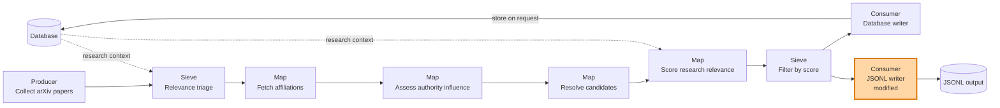
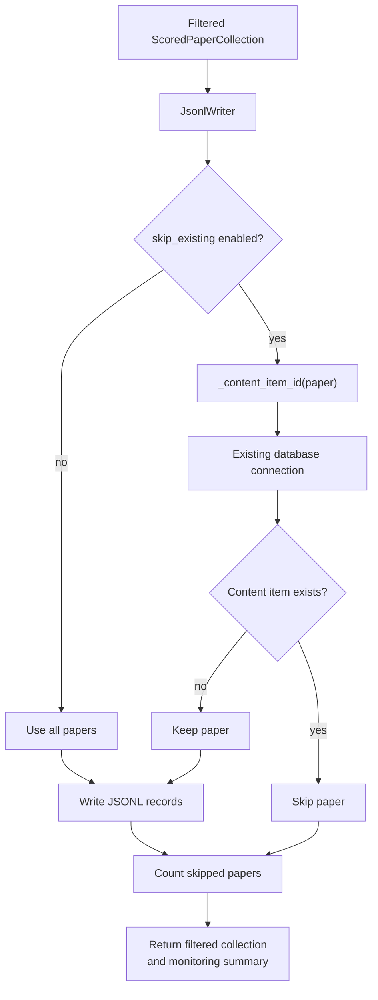

## Skip existing papers in the JSONL writer

### 1. Requirement analysis

- **R1 — Optional duplicate filtering:** `JsonlWriter` shall support an option that controls whether it skips papers already stored in the database.
  - **B1:** When disabled, the writer shall keep its current behavior and write every input paper.
  - **B2:** When enabled, the writer shall skip papers whose database identifier already exists.
- **R2 — Shared identity:** Duplicate detection shall use the same paper identifier derivation as `ContentItemDbWriter`, including arXiv-based identifiers and title-based fallback identifiers.
- **R3 — Existing database connection:** When duplicate filtering is enabled, the pipeline shall pass its existing database connection to `JsonlWriter`. The writer shall not open a second database connection.
- **R4 — Pass-through contract:** The writer shall return a `ScoredPaperCollection` containing only the papers it writes.
- **R5 — Monitoring:** The writer shall report the number of written and skipped papers.
- **R6 — Backward compatibility:** Existing configurations and calls that do not enable duplicate filtering shall continue to work without a database connection.

### 2. Tests

- **T1 (R1, B1):** `tests/test_paper_collection.py::TestJsonlWriter::test_skip_existing_disabled_writes_without_database` creates a `JsonlWriter` with duplicate filtering disabled and no database connection. It verifies that the paper is written and the returned collection contains it.
- **T2 (R1, B2, R2, R3):** `tests/test_paper_collection.py::TestJsonlWriter::test_skip_existing_filters_using_shared_connection` creates a database containing an existing paper, passes its connection to the writer, and verifies that only the new paper is written.
- **T3 (R2):** `tests/test_paper_collection.py::TestJsonlWriter::test_skip_existing_uses_arxiv_and_title_identifiers` verifies arXiv-based and title-based identifiers.
- **T4 (R4, R5):** `tests/test_paper_collection.py::TestJsonlWriter::test_skip_existing_reports_written_and_skipped_counts` verifies the filtered return collection and monitoring counts.
- **T5 (R6):** Existing `TestJsonlWriter` tests and the paper pipeline tests in `tests/test_paper_collection.py` and `tests/test_newest_paper_script.py` verify unchanged behavior when duplicate filtering is disabled.

All tests use temporary databases and files. They do not make network requests.

### 3. Implementation plan

#### 3.1 Implementation repos

- `/home/tony/reps/github/anton-pershin/mourat`

#### 3.2 High-level design

#### 3.3 Component design

The existing paper collection pipelines keep their database connection open while the enabled writers run. `JsonlWriter` reuses `_content_item_id` from `mourat.writers.db_writer`. Duplicate filtering is disabled by default.

#### 3.4 Todo list

1. [x] Write the tests.
2. [x] Run all the tests and ensure that the new tests fail.
3. [x] Add an explicit `skip_existing` option to `JsonlWriter`, disabled by default.
4. [x] Add an optional database connection parameter to `JsonlWriter`.
5. [x] Reuse `_content_item_id` from `ContentItemDbWriter` for duplicate checks.
6. [x] Filter existing papers before writing JSONL records.
7. [x] Return the filtered collection and report written and skipped counts.
8. [x] Pass the existing pipeline database connection to `JsonlWriter` when configured.
9. [x] Update Hydra configuration with the new option while preserving the current default behavior.
10. [x] Run the focused tests, relevant paper-pipeline tests, the full test suite, and linters.
11. [x] Update this spec with completed checklist items, actual test names, and the final modification summary.
12. [ ] Run the manual live acceptance check with duplicate filtering enabled and disabled.

#### 3.5 Modification summary

| File | Action |
|---|---|
| `mourat/writers/jsonl_writer.py` | Modified: add optional duplicate filtering, accept an existing database connection, reuse paper identifier derivation, and report written/skipped counts. |
| `mourat/scripts/collect_influential_papers_from_scratch.py` | Modified: pass the existing database connection to `JsonlWriter` when configured, and keep the connection open until both writers finish. |
| `mourat/scripts/collect_newest_papers.py` | Modified: pass the existing database connection to `JsonlWriter` when configured, and keep the connection open until both writers finish. |
| `config/jsonl_writer/default.yaml` | Modified: add the disabled-by-default duplicate-filtering option and its connection requirement. |
| `tests/test_paper_collection.py` | Modified: add tests for disabled and enabled duplicate filtering, arXiv and title-based identifiers, shared connection use, returned collections, monitoring counts, and unchanged output behavior. |

No database schema changes are planned.
