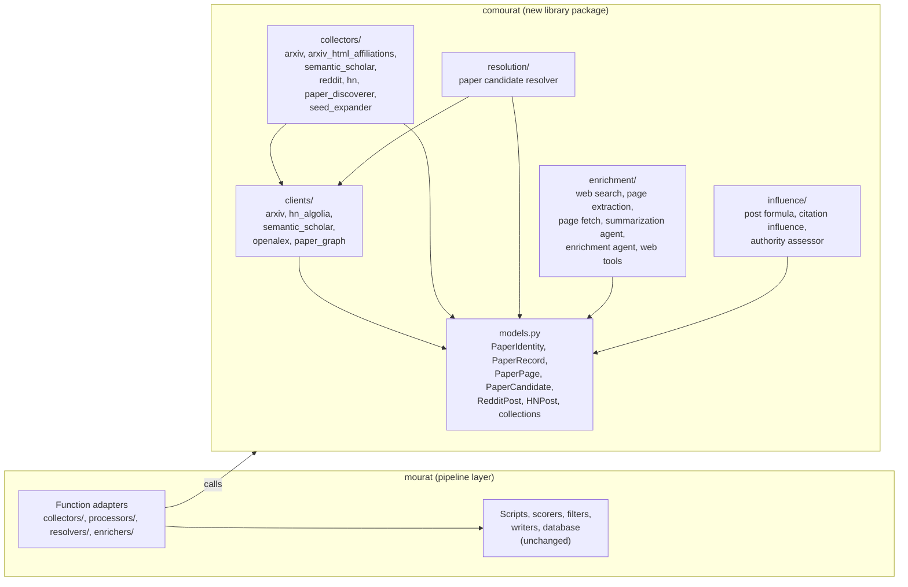

## Comourat: reusable collection and web enhancement library

### 1. Executive summary

#### 1.1 Spec description

This spec creates a reusable library package `comourat/` inside the mourat repository. The package collects posts and papers from Internet sources and enhances collected items with web search and web page extraction. It supports retrieving one collected item by its identifier. The package defines its own neutral input and output types, assesses influence scores, uses plain object-oriented classes, and does not depend on mourat's pipeline framework (`Function`, monitoring handlers), database, output writers, or Hydra configuration. Mourat keeps its collection workflows: their collectors, processors, and influence assessors become thin adapters that call `comourat` classes and present results as `Function[InputT, OutputT]` stages.

#### 1.2 Spec motivation

Issue #15 requests a separately usable library for collection and web enhancement so another project can reuse these capabilities without depending on mourat internals or copying code. Today these capabilities are entangled with mourat's pipeline wrappers and Pydantic collection models. This spec makes the boundary explicit: `comourat` is framework-free and reusable; mourat owns workflow orchestration, persistence, and outputs.

#### 1.3 Implementation repos

The `anton-pershin/mourat` repository only. This spec creates the `comourat/` package inside it and adapts mourat to use it. Moving the package to a separate repository is out of scope for this spec and is planned as a follow-up step outside the scope of this document.

### 2. Requirement analysis

#### 2.1 Functional requirements

**FR1 — Paper source clients and identity-based retrieval.** The library provides paper source clients for arXiv, Semantic Scholar, and OpenAlex. Each client supports retrieving one paper by identifier (arXiv ID or DOI), provider search, and citation-graph navigation (citations of a paper and references of a paper). The arXiv client also retrieves one paper's metadata and HTML page by arXiv ID. Clients communicate with the real HTTP APIs.

**FR2 — Post and paper collection.** The library collects posts (Reddit, Hacker News) and paper candidates (arXiv entries, Semantic Scholar results, LLM-driven paper discovery, seed expansion) using the real source APIs.

**FR3 — Neutral data types.** The library defines its own Pydantic models for the items it produces and consumes: paper identities, paper records, paper pages, paper candidates, and post models for Reddit and Hacker News. These models carry influence score fields (in-flight influence scores written by the library's assessors). They carry no relevance scores and no research-context fields; those remain mourat-side.

**FR4 — Web enhancement.** The library enhances collected items with web search and web page extraction: a standalone web search tool, a standalone page extraction helper, and an LLM enrichment agent that uses both tools. The enrichment prompt is provided by the caller; the library provides the tools and the agent mechanics.

**FR5 — Framework independence.** The library contains no imports from `mourat.*` and uses no `Function` classes, monitoring handlers, database, writer, or Hydra configuration. All configuration, including credentials, prompts, and breakpoint tables, is passed as plain constructor arguments. Mourat collectors, the paper resolver, clients, enhancers, and influence assessors listed in the modification summary use thin `Function` adapters over comourat classes. The `SeedResolver` stays in mourat because it resolves mourat content items.

**FR6 — Influence score assessment.** The library assesses influence scores:
- Post influence: the normalization formula mapping a raw post score and a reference level onto 0–100 (score at the reference level is 50, saturating at both ends), for Reddit and Hacker News posts.
- Paper citation influence: field-weighted citation impact preferred, citations-per-year fallback, mapped onto 0–100 through a caller-provided breakpoint table.
- Authority influence: a batched LLM assessment of paper authors and affiliations onto 0–100, judged against a caller-provided system prompt (a default prompt ships with the library), with bounded retries, a follow-up call for missing verdicts, and fail-open scoring of 0.

**FR7 — Paper candidate resolution.** After collection, comourat resolves paper candidates to canonical paper records. It tries an arXiv ID or DOI, including an arXiv ID found in the candidate's URLs, then searches by title when identity lookup finds no record. It accepts a record only when its title meets a caller-configured similarity threshold. It returns canonical records or unresolved outcomes.

#### 2.2 Non-functional requirements

**NFR1 — Behavior preservation.** Collection, client, resolution, and influence-assessment behavior is preserved: same HTTP endpoints, parameters, retries, limits, filtering and conversion logic, title-match threshold behavior, resolution order, normalization and interpolation formulas, and authority retry, follow-up, and fail-open behavior. The refactor is extraction plus adapters, not a redesign. Exception-handling code that exists to feed monitoring stays in mourat's `Function` wrappers.

**NFR2 — Dependency hygiene.** The library declares its own dependencies (pydantic, pydantic-ai, requests, trafilatura, and the LLM provider package). It does not import mourat's dependencies that belong to pipeline orchestration only. mourat declares a dependency on the library package (as a path/local dependency while comourat lives in this repository).

**NFR3 — Testability.** The library's public classes are testable without mourat's test fixtures; existing mourat tests keep passing after the adapters are introduced.

### 3. Acceptance criteria

Acceptance is verified by tests in the repository's test suite (the project has no validation subproject).

**AC1 (FR1, NFR1).** For each paper client (arXiv, Semantic Scholar, OpenAlex) inside comourat, tests verify identity-based retrieval (by arXiv ID and by DOI where the provider supports it), provider search, and citation-graph navigation, using mocked HTTP responses matching the real API shapes. The mocked endpoints, parameters, and response parsing match the current mourat clients.

**AC2 (FR2, NFR1).** Tests verify that comourat's collection classes produce their neutral collections from mocked source APIs (Reddit, HN Algolia, arXiv RSS/API, Semantic Scholar bulk search, and the LLM discovery agent with mocked model calls), with the same conversion and filtering logic as the current mourat collectors.

**AC3 (FR6, NFR1).** Tests verify the three influence mechanisms: the post normalization formula (0 -> 0, reference -> 50, saturation at both ends), the paper citation influence mapping (fwci preferred, citations-per-year fallback, breakpoint interpolation with saturation), and the authority assessor (bounded retry on batch failure, single follow-up call for missing verdicts, fail-open score 0, silent discard of unknown verdict ids), using mocked LLM calls.

**AC4 (FR3).** Tests verify the comourat models: post models and paper candidate/record models accept and carry influence score fields; serialization round-trips; and the models contain no relevance-score or research-context fields.

**AC5 (FR4).** Tests verify the web enhancement surface: the web search tool and page extraction helper return extracted content from mocked HTTP/HTML, and the enrichment agent mechanics (tool attachment, tool-call budget guard, usage limits) behave as today, using mocked model calls.

**AC6 (FR5).** A static test asserts that no module under `comourat/` imports `mourat.*`. A test asserts that comourat classes accept all configuration as constructor arguments (no Hydra or environment lookups inside the library).

**AC7 (FR5, NFR3).** After the adapters are introduced, every existing mourat test passes unchanged in behavior: the collection workflows produce the same outputs as before, with collectors, processors, resolvers, and assessors implemented as `Function` wrappers over comourat classes. The full existing test suite passes.

**AC8 (FR7, NFR1).** Tests verify that comourat resolves candidates by identifier, falls back to title search, rejects title mismatches, and reports unresolved candidates, using mocked clients.

Note: AC7's "same outputs as before" is checked by the existing test suite, which already pins collector and processor behavior through mocks; no new golden-output fixtures are planned.

### 4. Insight

No insight is needed.

### 5. Overall solution design

#### 5.1 High-level design

The constitution section 5.1 pipeline diagrams remain valid and unchanged: all five collection workflows keep the same filters, names, and order. This spec changes nothing at the pipeline level, so no pipeline flowchart is highlighted; the change sits below the pipeline level, inside the filters. After this spec, each filter shown in the constitution diagrams is internally backed by a comourat class where the modification table says so.

The component-level design adds one new package and one adapter layer:

Arrows represent actual Python imports and calls. The dependency direction is one-way: mourat adapters call comourat; comourat imports nothing from mourat (enforced by AC6).

#### 5.2 Core components

Two-level hierarchy: first level is the package, second level is the component group.

**comourat (new package, top-level sibling of `mourat/`)**

- `comourat/models.py` — neutral Pydantic models moved from mourat where they are collection-bound: `PaperIdentity`, `PaperRecord`, `PaperPage` (from `clients/paper_graph.py`), `PaperCandidate`/`PaperCandidateCollection`, `PaperInfo`/`PaperInfoCollection`, post models `RedditPostInfo`/`RedditPostCollection`, `HNPostInfo`/`HNPostCollection`. Scoring models (`ScoreEntry`, `ScoringResult`, `Scored*`), research-context models, `InfluenceMetric`, and enrichment-side mourat models stay in `mourat/data_models.py`. Models carry influence score fields per FR3.
- `comourat/clients/` — moved code: `arxiv.py`, `hn_algolia.py`, `semantic_scholar.py`, `openalex.py`, `paper_graph.py`. Behavior unchanged (NFR1).
- `comourat/collectors/` — the collection logic of `mourat/collectors/` (arXiv, arXiv HTML affiliations, Semantic Scholar, Reddit, HN, paper discoverer, seed expander) as plain classes with constructor-argument configuration; the LLM-discovery and seed-expansion logic moves here with the pydantic-ai agent construction.
- `comourat/resolution/` — paper candidate resolution from canonical identity or title search, with title-match verification and neutral success/unresolved results. The resolver uses comourat clients and models; it contains no mourat pipeline or database types.
- `comourat/enrichment/` — the web search and page extraction tools from `mourat/tools/web.py`, the page-fetch/extract logic of `mourat/processors/hn_fetcher.py`, the summarization agent mechanics of `mourat/processors/hn_summarizer.py`, and the enrichment agent of `mourat/enrichers/web_enricher.py` (agent built from a caller-provided prompt).
- `comourat/influence/` — `compute_influence_score` and post normalization (from `processors/post_influence.py`), the citation-influence mapping (fwci preferred, citations-per-year fallback, breakpoint interpolation) from `processors/influence_assessor.py`, and the batched authority assessor from `processors/authority_influence.py` with its retry, follow-up, and fail-open semantics.
- `comourat/py.typed` and comourat dependency declarations in `pyproject.toml`.

**mourat (modified adapter layer + unchanged orchestration)**

- Every modified collector, processor, resolver, and enhancer keeps its class name, its `Function[InputT, OutputT]` type, and its position in the pipelines; its body delegates to the comourat class and converts between mourat collection models and comourat models only where a model had to split (for example, `PaperCandidate` keeps mourat-only fields such as provenance and announce type in the mourat model; the comourat model carries the neutral subset). `SeedResolver` remains in mourat.
- `mourat/base.py`, `mourat/monitoring.py`, scorers, filters, writers, database, scripts, and Hydra configs: unchanged.
- `pyproject.toml`: declare comourat as a package of this repository (single-distribution setup with both packages; no separate install step while comourat lives here).

### 6. Implementation plan

#### 6.1 Todo list

The plan is ordered bottom-up: models, clients, collectors, resolution, influence, enrichment, then adapters and tests. Keep the full suite green at each step.

1. Create the `comourat/` package skeleton (`__init__.py`, `py.typed`) and add the comourat package declaration to `pyproject.toml`.
2. Create `comourat/models.py` with neutral models. Keep mourat-only fields in the extended mourat models.
3. Move client implementations to `comourat/clients/`; update all import sites to use comourat directly. Remove `mourat/clients/`.
4. Extract collection logic for arXiv, arXiv HTML affiliations, Semantic Scholar, Reddit, HN, paper discovery, and seed expansion. Keep mourat collectors as `Function` adapters.
5. Add `comourat/resolution/paper_resolver.py` for candidate identity lookup, title fallback, and title-match verification. Keep `mourat/resolvers/paper_resolver.py` as a `Function` adapter. Keep `SeedResolver` in mourat.
6. Extract influence logic to `comourat/influence/`; rework the mourat processors as adapters.
7. Extract enrichment logic to `comourat/enrichment/`; rework the mourat processors and enrichers as adapters. Remove duplicate mourat client and web-tool modules after all import sites use comourat.
8. Add comourat tests for AC1-AC6 and AC8, including mocked resolver tests; add the AC6 static import test.
9. Run the full test suite (AC7), `black` on touched files, and pylint errors-only on touched files. Fix or amend as needed.
10. Update terminology and the constitution only if required, with explicit user approval for constitution changes.
11. Commit and push the spec and implementation. Open the PR `Implemented 22: comourat reusable collection and web enhancement library`.

#### 6.2 Modification summary

| File | Action |
|------|--------|
| `comourat/__init__.py` | New: package marker, public exports |
| `comourat/py.typed` | New |
| `comourat/models.py` | New: neutral models moved from mourat |
| `comourat/clients/arxiv.py`, `hn_algolia.py`, `semantic_scholar.py`, `openalex.py`, `paper_graph.py` | New: moved from `mourat/clients/` |
| `comourat/clients/__init__.py` | New |
| `comourat/collectors/arxiv.py`, `arxiv_html_affiliations.py`, `semantic_scholar.py`, `reddit.py`, `hn.py`, `paper_discoverer.py`, `seed_expander.py` | New: collection logic extracted from `mourat/collectors/` |
| `comourat/collectors/__init__.py` | New |
| `comourat/resolution/paper_resolver.py`, `__init__.py` | New: neutral candidate resolution using comourat clients |
| `comourat/enrichment/web_tools.py`, `page_fetch.py`, `summarizer.py`, `enricher.py` | New: extracted from `mourat/tools/web.py`, `processors/hn_fetcher.py`, `processors/hn_summarizer.py`, `enrichers/web_enricher.py` |
| `comourat/enrichment/__init__.py` | New |
| `comourat/influence/post.py`, `citation.py`, `authority.py` | New: extracted from `processors/post_influence.py`, `influence_assessor.py`, `authority_influence.py` |
| `comourat/influence/__init__.py` | New |
| `mourat/data_models.py` | Modified: keep mourat-only models and re-export the neutral models from comourat |
| `mourat/clients/` | Removed: all import sites now use `comourat.clients` directly |
| `mourat/collectors/*` (7 files) | Modified: thin `Function` adapters over comourat classes |
| `mourat/resolvers/paper_resolver.py` | Modified: thin `Function` adapter over `comourat.resolution.PaperResolverCore` |
| `mourat/resolvers/seed_resolver.py` | Unchanged: remains mourat-specific |
| `mourat/processors/post_influence.py`, `influence_assessor.py`, `authority_influence.py` | Modified: thin `Function` adapters |
| `mourat/processors/hn_fetcher.py`, `hn_summarizer.py` | Modified: thin `Function` adapters |
| `mourat/enrichers/web_enricher.py` | Modified: thin `Function` adapter |
| `mourat/tools/web.py` | Removed: all web-tool users now import from comourat |
| `pyproject.toml` | Modified: add comourat package declaration and dependencies |
| `tests/test_comourat_*.py` (new test files) | New: AC1-AC6 and AC8 tests |
| `tests/test_*` (existing files touching moved code) | Modified: import paths only where modules moved |
