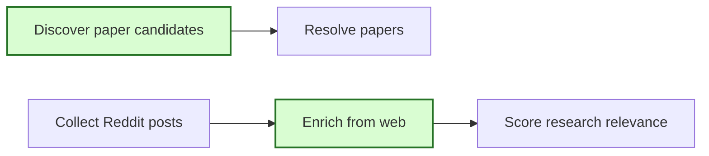
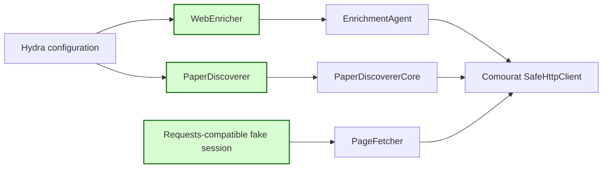

## Comourat fetch compatibility

### 1. Requirement analysis

- **R1 — Requests-compatible test transport.** HN content-fetch tests must use a scripted HTTP session that implements the `requests.Session` interface required by the protected comourat client. The tests must retain their current response and proxy assertions.
- **R2 — Explicit proxy injection.** `WebEnricher` and `PaperDiscoverer` must accept an optional proxy URL and pass it to their comourat cores. The Hydra configurations must supply `SEMANTIC_SCHOLAR_PROXY` explicitly when it is set.
- **R3 — Existing behavior without a proxy.** Existing constructor calls and configurations that leave the proxy null must remain valid. Comourat must not read proxy configuration implicitly from the environment.
- **R4 — No substitute fetcher.** Mourat must not add another HTTP fetch implementation. It must use the public comourat interfaces and their protected transport.
- **R5 — Isolated verification.** Validation must run in the dedicated mourat worktree with `/home/tony/venvs/mourat` and the updated comourat checkout. Tests must not require live network access.

Expected behavior variants:

- **B1 — Existing calls.** Callers that do not pass `proxy` use the same constructor defaults as before.
- **B2 — Configured proxy.** A caller-provided or Hydra-provided proxy reaches the corresponding comourat core.
- **B3 — Scripted HN responses.** The updated fake session works with `SafeHttpClient` while returning the same test responses.
- **B4 — Comourat data compatibility.** OpenAlex records keep their pre-existing abstract behavior; the related comourat change is reverted in its own repository.

### 2. Tests

- **T1 — HN transport compatibility.** Run all HN content-fetcher tests with the updated scripted session. Confirm that extraction, failure handling, and proxy assertions still pass.
- **T2 — Constructor forwarding.** Verify that `WebEnricher` forwards its proxy to `EnrichmentAgent` and `PaperDiscoverer` forwards its proxy to `PaperDiscovererCore`. Verify that null is the default.
- **T3 — Hydra forwarding.** Compose the Reddit enrichment and paper-discovery configurations with a test proxy and verify that the composed proxy value reaches the component configuration.
- **T4 — Full regression suite.** Run all 399 mourat tests with the updated comourat checkout and confirm that no test fails.
- **T5 — Comourat regression verification.** Run all comourat tests and quality checks after reverting the unrelated OpenAlex behavior change.

### 3. Implementation plan

#### 3.1 Implementation repos

- `anton-pershin/mourat`: management repository and implementation repository for this spec.
- `anton-pershin/comourat`: implementation repository for the separate OpenAlex compatibility revert.

#### 3.2 High-level design

The first diagram copies the affected stages from the constitution diagrams and marks them in green.

The second diagram shows explicit proxy forwarding and the Requests-compatible test double.

#### 3.3 Todo list

1. [x] Write the compatibility and configuration tests.
2. [x] Run the tests and confirm the expected failures.
3. [x] Update the scripted HN session to implement `requests.Session`.
4. [x] Add optional proxy forwarding to both adapters and their Hydra configurations.
5. [x] Revert the unrelated OpenAlex behavior change in comourat PR #8.
6. [x] Run focused compatibility tests and the full 399-test mourat suite.
7. [x] Run comourat tests and quality checks, then push and review both changes.

#### 3.4 Modification summary

| File | Action |
|------|--------|
| `.internal/specs/23-comourat-fetch-compatibility-kiss-spec.md` | New: compatibility requirements and verification plan |
| `tests/test_hn_pipeline.py` | Modified: make the scripted session Requests-compatible |
| `tests/test_enrichers.py` | Modified: verify enrichment proxy forwarding |
| `tests/test_paper_collection.py` | Modified: verify discovery proxy forwarding |
| `tests/test_hn_config.py` | Modified: verify Hydra proxy composition |
| `mourat/enrichers/web_enricher.py` | Modified: accept and forward an optional proxy |
| `mourat/collectors/paper_discoverer.py` | Modified: accept and forward an optional proxy |
| `config/config_collect_posts.yaml` | Modified: configure the enrichment proxy explicitly |
| `config/paper_discoverer/default.yaml` | Modified: configure the discovery proxy explicitly |
| `comourat/clients/openalex.py` in the comourat repository | Modified: restore the existing abstract behavior |
