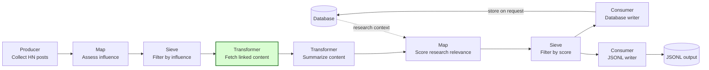
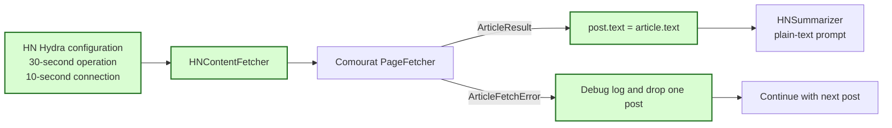

## HN article result compatibility

### 1. Requirement analysis

Comourat PR #13 changed `PageFetcher.fetch`. It now returns an `ArticleResult` after a successful fetch and raises `ArticleFetchError` for an expected failure. `HNContentFetcher` must use this contract without changing the HN pipeline stages.

- **R1 — Plain article text.** `HNContentFetcher` must assign only `article.text` to `post.text`. A serialized HN post must contain a string in its `text` field. `HNSummarizer` must receive the article text, not the representation of an `ArticleResult` object.
- **R2 — Expected failure isolation.** `HNContentFetcher` must catch `ArticleFetchError` for each post. It must log the post identifier, stable error category, and sanitized error message at debug level. It must drop only the failed post, continue with later posts, and preserve the kept and dropped monitoring counts.
- **R3 — Unexpected failure separation.** An unexpected adapter exception must not use the expected article-failure path. It must propagate so that a contract or adapter defect remains visible.
- **R4 — Complete article cases.** Tests must use response doubles with `url` and `close()`. Successful HTML must contain a title. Tests must cover success, unavailable content, empty text, a missing title, extractor failure, provider failure, invalid input, connection timeout, and overall operation timeout.
- **R5 — Required article title.** The `HNContentFetcher` documentation must state that an article without a non-empty extracted title is dropped as `empty_extraction`, including when its text is extractable.
- **R6 — Separate timeout scopes.** `HNContentFetcher` must expose `connection_timeout` with a default of 10 seconds and forward it to `PageFetcher`. The existing `timeout` setting must remain the overall operation timeout with a default of 30 seconds. The Hydra configuration and adapter documentation must explain both scopes.
- **R7 — Reviewed dependencies.** `pyproject.toml` and `requirements.txt` must select Comourat commit `d82a29f87b858024615f8f56c4059c11b043bdd9`. This revision contains the reviewed article and enrichment contracts. The declarations must require `pydantic-ai` 2.64.0 or later, as required by that Comourat revision. Issue #18 and PR #21 must retain or advance this commit when the branches are combined. This spec does not implement the `WebEnricher` changes from issue #18.
- **R8 — Offline verification.** The complete Mourat test suite and quality checks must run against the selected Comourat commit. Tests must use controlled doubles and must not require live network access.

Expected behavior variants:

- **B1 — Successful article.** The output post contains only the stripped plain article text returned by Comourat.
- **B2 — Expected article failure.** The failed post is absent, the next post can succeed, and monitoring reports the correct input, output, and dropped counts.
- **B3 — Missing title with extractable text.** The post is dropped with category `empty_extraction`.
- **B4 — Unexpected adapter failure.** The exception propagates and is not reported as an expected article failure.
- **B5 — Default timeout configuration.** The overall operation timeout is 30 seconds and each connection attempt has a 10-second cap.
- **B6 — Custom timeout configuration.** Caller-provided overall and connection timeouts reach the Comourat core independently.

### 2. Tests

- **T1 (R1, B1) — Article text and serialization.** Fetch a title-bearing response through the scripted session. Assert that `post.text` is the extracted string and that JSON serialization keeps `text` as a string.
- **T2 (R1) — Plain summarization input.** Pass the fetched post to `HNSummarizer`. Assert that its prompt contains the article text and does not contain an `ArticleResult` representation.
- **T3 (R2, R4, R5, B2, B3) — Expected failures and continuation.** Use scripted responses and extractor behavior for unavailable content, empty text, missing title, extractor failure, HTTP provider failure, connection failure, invalid input, and connection timeout. End the sequence with a successful post. Assert all expected categories and sanitized messages in the adapter logs, absence of provider details, the kept post, and the monitoring counts.
- **T4 (R2, R4, B2) — Overall timeout and continuation.** Make extraction for one post exceed a short overall timeout. Assert that the post is dropped as `timeout` and a later post succeeds.
- **T5 (R3, B4) — Unexpected adapter failure.** Replace the core fetch operation with an unexpected exception and assert that it propagates.
- **T6 (R6, B5, B6) — Timeout forwarding and configuration.** Assert the default and custom core timeout values. Compose the HN Hydra configuration and assert values of 30 and 10 seconds.
- **T7 (R2, R6) — Existing proxy behavior.** Retain the existing assertion that the configured proxy reaches the HTTP session.
- **T8 (R7) — Dependency selection.** Inspect the runtime dependency declarations and assert the full reviewed Comourat commit and the minimum `pydantic-ai` version.
- **T9 (R8) — Regression and quality checks.** Run the complete test suite, Black, isort, pylint, and mypy against the selected Comourat commit without live network access.

### 3. Implementation plan

#### 3.1 Implementation repos

- `anton-pershin/mourat`: management repository and implementation repository.
- `anton-pershin/comourat`: read-only dependency at the reviewed commit. No change is required.

#### 3.2 High-level design

The first diagram copies the HN pipeline from the constitution and marks the modified fetch stage in green.

The second diagram shows the adapter contract. Green nodes are modified in this spec.

#### 3.3 Todo list

1. [x] Write the tests.
2. [x] Run the focused tests and confirm the expected failures.
3. [x] Adapt article text assignment and expected failure handling.
4. [x] Add timeout configuration and adapter documentation.
5. [x] Pin and document the compatible runtime dependencies.
6. [x] Run the complete test suite and quality checks without live network access.
7. [x] Coordinate the dependency revision with issue #18 and PR #21.

#### 3.4 Modification summary

| File | Action |
|------|--------|
| `.internal/specs/24-hn-article-result-compatibility-kiss-spec.md` | New: requirements, tests, and implementation plan |
| `mourat/processors/hn_fetcher.py` | Modified: consume article text, handle expected failures, expose timeouts, and document title behavior |
| `config/config_collect_hn_posts.yaml` | Modified: configure and document both timeout scopes |
| `pyproject.toml` | Modified: select the reviewed Comourat commit and compatible Pydantic AI version |
| `requirements.txt` | Modified: keep runtime installation dependencies consistent with package metadata |
| `README.md` | Modified during the merge: document the selected Comourat revision and both contracts |
| `tests/test_hn_pipeline.py` | Modified: update response doubles and add article contract regressions |
| `tests/test_hn_config.py` | Modified: verify timeout configuration and dependency selection |
| `tests/test_enrichers.py` | Modified during the merge: keep the inherited dependency assertion aligned with the selected Comourat revision |
