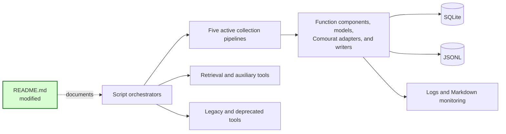
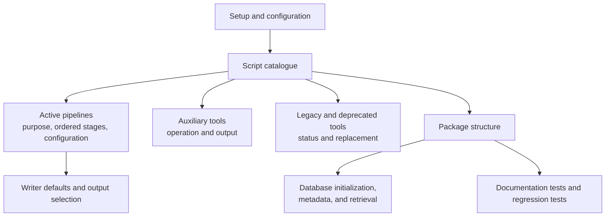

## Update the README to match the implementation

### 1. Requirement analysis

- **R1 — Setup and configuration.** The README must describe the supported Python version, dependency installation, environment variables, Hydra configuration, command-line overrides, output files, and development checks.
- **R2 — Complete script coverage.** The README must document every executable module in `mourat/scripts/`, except the package marker `__init__.py`. Each script entry must give its purpose, its main configuration file, and its status as active, auxiliary, legacy, or deprecated.
- **R3 — Current pipeline structure.** Each active collection-script entry must list its processing stages in code order. The stage names, score ranges, filtering behavior, and writer behavior must agree with the implementation.
- **R4 — Shared internal structure.** The README must explain the responsibilities of the script orchestrators, `Function` components, Pydantic models, Comourat adapters, processing modules, writers, monitoring, configuration, and database modules. It must identify Comourat as an external dependency.
- **R5 — Storage and retrieval instructions.** The README must give working database-initialization examples and document only the query types exposed by `retrieve_content.py`.

Expected behavior variants:

- **B1 — Collection pipelines.** A reader can compare the five active collection pipelines by their sources and ordered stages.
- **B2 — Auxiliary tools.** A reader can identify the calibration, retrieval, query-generation, and candidate-topic tools and their outputs.
- **B3 — Old scripts.** A reader can distinguish the legacy Semantic Scholar script and the deprecated Reddit-summary script from supported collection pipelines.
- **B4 — Output selection.** A reader can enable or disable SQLite and JSONL writers and find the default writer state for each active collection pipeline.

### 2. Tests

- **T1 (R2, B1, B2, B3):** Parametrized tests in `tests/test_readme.py` must discover every script module and require a README section and the full path of its matching Hydra configuration file.
- **T2 (R3, B1):** Parametrized tests must require the current ordered stage-class names in each active collection-pipeline section. The newest-paper section must not describe the retired binary-classifier pipeline.
- **T3 (R1, R4):** A test must require the shared architecture paths, the `Function` abstraction, and the external Comourat dependency in the README.
- **T4 (R5):** A test must require the five query types implemented by `retrieve_content.py` and must reject a nonexistent CLI constraint-query type.
- **T5 (R1, R2, R3, R4, R5, B4):** A manual documentation review must compare setup instructions, writer defaults, examples, and pipeline descriptions with the scripts and Hydra files.
- **T6 (Regression):** Run the complete pytest suite. All tests must pass without network access.

### 3. Implementation plan

#### 3.1 Implementation repos

- `anton-pershin/mourat`: management repository and implementation repository.

#### 3.2 High-level design

No runtime component changes. The README becomes the documentation entry point for the existing pipelines and shared components.

The documentation has this internal structure:

#### 3.3 Todo list

1. [ ] Write the documentation consistency tests.
2. [ ] Run the new tests and ensure that they fail against the old README.
3. [ ] Rewrite the README from the script and Hydra configuration evidence.
4. [ ] Run the documentation tests and complete the manual documentation review.
5. [ ] Run the complete test suite and applicable quality checks.
6. [ ] Update this specification with the completed checks and final file summary.

#### 3.4 Modification summary

| File | Action |
|------|--------|
| `.internal/specs/26-update-readme-kiss-spec.md` | New: requirements, documentation tests, and implementation plan. |
| `tests/test_readme.py` | New: script coverage, pipeline-stage, architecture, and retrieval-documentation checks. |
| `README.md` | Modified: replace outdated instructions and add complete script and architecture documentation. |
