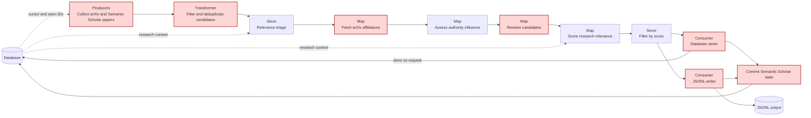
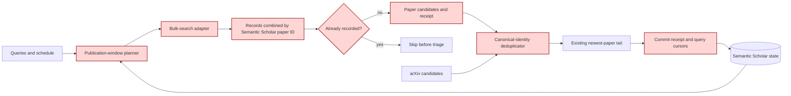

## Semantic Scholar in newest-paper collection

### 1. Executive summary

#### 1.1 Spec description

The newest-paper pipeline will collect papers from arXiv, Semantic Scholar, or both sources. Semantic Scholar collection will use configured bulk-search queries and publication-date windows. A durable cursor and paper ledger will limit repeated work, and canonical paper identity will prevent duplicate output.

#### 1.2 Spec motivation

Some papers are published in journals without an arXiv preprint. Semantic Scholar support will make these papers available to the existing relevance, influence, and output stages. Date windows and durable state are necessary because Semantic Scholar publication dates are not ingestion dates.

#### 1.3 Implementation repos

The `anton-pershin/mourat` repository only. The existing Comourat revision does not expose the Semantic Scholar paper ID or external identifiers from bulk search. This spec adds a pipeline-specific Semantic Scholar adapter in `mourat`; it does not require a Comourat change.

### 2. Requirement analysis

#### 2.1 Functional requirements

**FR1 — Source selection.** The `sources` configuration accepts `arxiv`, `semantic_scholar`, or both. The default enables both sources. An empty selection, an unknown source, or a duplicate source is an error. Existing arXiv feed behavior remains unchanged when arXiv is enabled.

**FR2 — Semantic Scholar queries.** The Semantic Scholar source runs one or more configured strict keyword queries through the Graph API bulk-search endpoint. At least one non-empty query is required when the source is enabled. Requests use `publicationDateOrYear`, sort by descending publication date, follow continuation tokens, and request `paperId`, title, URL, abstract, authors, publication date, and external identifiers. `SEMANTIC_SCHOLAR_API_KEY` supplies the optional API key without logging it.

**FR3 — Hybrid publication-date schedule.** The source uses a delayed daily cursor with periodic backfill. The target end date is the UTC run date minus `publication_lag_days`, with a default lag of 30 days. A new query starts with one `stride_days` window, whose default size is one day. An existing query resumes after its last completed end date and catches up to the target end date in chunks of at most `stride_days`.

The first run and each run for which `backfill_interval_days` has elapsed extend the requested range backwards by `backfill_days`. The defaults are a 90-day backfill every seven days. Overlapping normal and backfill ranges are combined. A zero backfill size disables backfill. `max_results_per_query` is optional; its default `null` processes every new record. Pagination always continues to exhaustion, including when a cap is set. A positive cap limits new records selected for downstream processing in one run. If records are deferred by the cap, the query cursor and last backfill date stay unchanged. The next run repeats the plan, filters committed IDs, and selects the next batch.

**FR4 — Durable collection state.** SQLite stores the last completed end date and last backfill date for each query. It also stores each selected Semantic Scholar paper ID, including IDs of papers later excluded or rejected. Records deferred by a processing cap stay uncommitted until their later batch is selected. Previously recorded IDs do not enter triage again. IDs returned by several queries in one run are combined before candidate conversion.

The pipeline commits new paper IDs and query cursors in one transaction only after collection, triage, influence assessment, scoring, filtering, and enabled writers finish. An exception before this point commits neither IDs nor cursors. A retry can therefore repeat work, but a failed run cannot advance past unprocessed papers.

**FR5 — Candidate conversion and source-specific stages.** A Semantic Scholar record becomes a `PaperCandidate` with normalized DOI and arXiv identifiers, abstract, authors, URL, publication date, and `semantic_scholar` provenance. Missing abstracts become empty strings. A Semantic Scholar-only candidate without a DOI is excluded before triage. A candidate without an arXiv ID keeps affiliations unknown in the existing arXiv HTML stage. A candidate with an arXiv ID can use that stage. The candidate converter preserves the DOI for persistence.

**FR6 — Cross-source deduplication.** A deterministic stage runs after all enabled producers and before triage. It compares normalized DOI and arXiv identities. It keeps one candidate for each paper and gives an arXiv RSS record precedence over a Semantic Scholar record. The primary record keeps its metadata. The merge combines provenance and fills only missing identifiers and URLs from the duplicate. Semantic Scholar metadata does not replace arXiv metadata.

**FR7 — Persistent paper identity.** Paper storage uses an arXiv-derived content-item ID when an arXiv ID is available, a normalized DOI-derived ID otherwise, and the existing title slug only when neither identifier exists. A paper-identity table maps DOI and arXiv aliases to one content item. The writer uses this table and legacy derived IDs to update or rekey an existing row instead of creating a second row. If an arXiv identity becomes available for a DOI-keyed row, the arXiv identity takes precedence. JSONL `skip_existing` uses the same identity lookup without changing the database.

**FR8 — Configuration and documentation.** The main configuration exposes source selection, queries, lag, stride, backfill, result limit, retry, and delay controls. The README explains all three source modes, the publication-date meaning, state commits, DOI exclusion, deduplication, and API-key configuration. The constitution diagram and terminology describe the source-neutral producer. `New submission` and `Author affiliation` remain arXiv-specific terms.

#### 2.2 Non-functional requirements

**NFR1 — Complete and bounded collection.** Pagination always continues to exhaustion. Each query and date range is visible in monitoring output. Paper-ID and cursor state advances only after successful completion. A query with records deferred by a processing cap keeps its previous cursor and backfill dates.

**NFR2 — API failure handling.** Rate-limit and server responses use bounded retries, exponential backoff, and `Retry-After` when supplied. Other client errors fail the run. Request delays and retry settings are configurable. Tests do not make live network requests.

**NFR3 — Existing behavior.** The legacy Semantic Scholar collector and other pipelines retain their public behavior. ArXiv-only HTTP behavior stays unchanged; Semantic Scholar uses a separate TLS-verifying client because its requests can carry an API key. The full existing test suite and repository quality checks pass.

### 3. Acceptance criteria

The project has no validation subproject. Mocked unit and integration tests verify these criteria.

**AC1 (FR1, FR8).** Configuration tests cover both sources, arXiv only, and Semantic Scholar only. Tests also cover empty, duplicate, and unknown source selections, and the required query setting.

**AC2 (FR2, FR3, NFR1, NFR2).** Mocked HTTP tests verify query parameters, requested fields, API-key headers, date ranges, continuation tokens, identifier conversion, retries, and complete pagination with and without a processing cap. A two-run cap test verifies that deferred records arrive in the next batch and that the cursor advances only then. Another test verifies that a capped run preserves the previous backfill date. Date-planning tests cover a new query, daily resume, a missed-run catch-up, a periodic backfill, disabled backfill, and an already current cursor.

**AC3 (FR4).** Database tests verify durable seen IDs and query state. A second-run integration test proves that triage receives no seen papers and that an empty database-writer batch does not block the state commit. Another integration test proves that state does not advance when a later stage raises an exception. A successful run commits all selected IDs, including irrelevant and no-DOI papers, in one transaction.

**AC4 (FR5, FR6).** Tests verify Semantic Scholar candidate mapping, no-DOI exclusion, unknown affiliations for DOI-only papers, and DOI preservation by the converter. Dedup tests cover DOI matches, arXiv matches, duplicates across queries, arXiv metadata precedence, and merged provenance.

**AC5 (FR7).** Writer tests cover arXiv-first, DOI-first, and title-fallback IDs; DOI normalization; repeated writes; DOI-first followed by arXiv enrichment; preservation of arXiv identity during a later DOI-only update; and JSONL skip-existing by either identity. A both-source integration test writes one row and one JSONL record for a shared paper and includes a DOI-only paper.

**AC6 (FR8, NFR3).** Documentation checks include the new producer and dedup stage in pipeline order. The legacy collector tests and the complete test suite pass. Formatting, import-order, and error-level static checks pass.

### 4. Insight

A rolling window without a cursor is simple but repeats the same API requests each day. A delayed stride without backfill uses fewer requests but can miss late-indexed papers after a failure or a long indexing delay. The selected hybrid keeps routine requests small, resumes failed date ranges, and periodically checks a configurable older range. The durable paper ledger removes repeated LLM work during overlap.

### 5. Overall solution design

#### 5.1 High-level design

The newest-paper part of the constitution changes as follows. Red nodes are new or modified.

The Semantic Scholar component has a planner, an HTTP adapter, and an explicit commit boundary:

#### 5.2 Core components

- `SemanticScholarNewestPaperCollector` plans query windows, performs complete bulk-search pagination, combines new records, and returns selected candidates. Its receipt contains selected provider IDs and the completed query states that a later commit will write. Deferred IDs and incomplete query states stay out of the receipt.
- `mourat.database.semantic_scholar` owns seen-ID queries and transactional state commits.
- `PaperCandidateDeduplicator` applies DOI exclusion and arXiv precedence before expensive stages.
- `ContentItemDbWriter` and `JsonlWriter` share canonical identity helpers. SQLite paper aliases preserve one row when source identifiers become available in different runs.
- `collect_newest_papers.py` selects producers, invokes deduplication, and commits Semantic Scholar state only after the output stages succeed.

### 6. Implementation plan

#### 6.1 Todo list

1. Write the automated tests for AC1–AC6.
2. Run the new tests and confirm that they fail for the missing behavior.
3. Add the Semantic Scholar schema, state repository, date planner, bulk-search adapter, and receipt commit.
4. Add candidate conversion and canonical-identity deduplication.
5. Extend candidate conversion and both writers with DOI identity and persistent aliases.
6. Rewire source selection and the deferred state commit in the newest-paper script.
7. Add Hydra configuration and update the README, constitution, and terminology.
8. Run the complete test suite and quality checks. Fix all regressions.
9. Review the specification against the implementation, commit all changes, push the assigned branch, and open the pull request.

#### 6.2 Modification summary

| File | Action |
|------|--------|
| `mourat/collectors/semantic_scholar_newest.py` | New: date planning, bulk search, candidate conversion, and collection receipt |
| `mourat/database/semantic_scholar.py` | New: seen-paper lookup and transactional collection-state commits |
| `mourat/database/schema.sql` | Modified: Semantic Scholar state and paper-identity tables |
| `mourat/database/content_item.py` | Modified: rekey and merge existing paper rows while preserving relations |
| `mourat/processors/paper_deduplicator.py` | New: DOI exclusion and cross-source deduplication |
| `mourat/processors/candidate_converter.py` | Modified: preserve DOI |
| `mourat/writers/db_writer.py` | Modified: DOI identity, aliases, and existing-row reconciliation |
| `mourat/writers/jsonl_writer.py` | Modified: shared DOI-aware identity lookup |
| `mourat/scripts/collect_newest_papers.py` | Modified: source selection, dedup stage, and deferred state commit |
| `config/config_collect_newest_papers.yaml` | Modified: source list and Semantic Scholar component defaults |
| `config/semantic_scholar_newest/default.yaml` | New: query, schedule, pagination, retry, and API settings |
| `config/paper_deduplicator/default.yaml` | New: canonical-identity deduplicator target |
| `tests/test_newest_semantic_scholar.py` | New: AC1–AC5 feature tests |
| `tests/test_newest_paper_script.py`, `tests/test_readme.py` | Modified: source-mode fixtures and documentation order |
| `README.md` | Modified: Semantic Scholar operation and configuration |
| `.internal/constitution-spec.md` | Modified: source-neutral producer and dedup stage |
| `.internal/terminology.md` | Modified: source and identity terms used by this spec |
