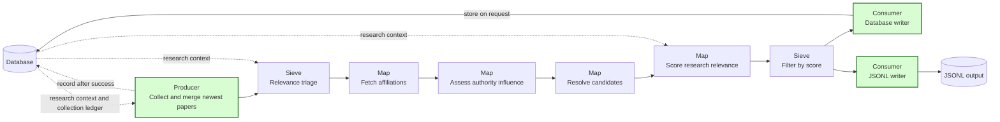
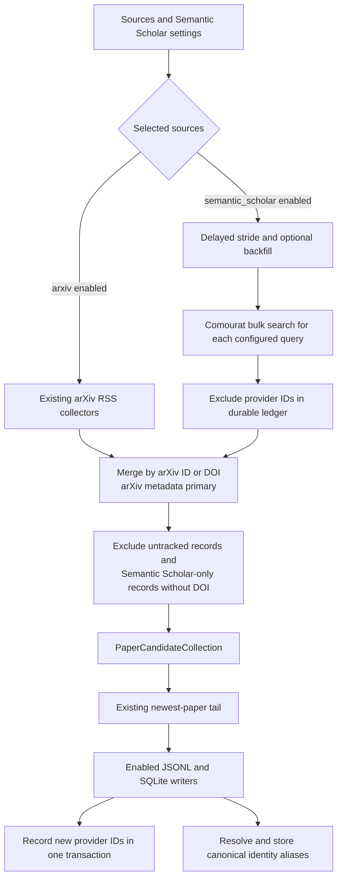

## Semantic Scholar in newest-paper collection

This spec implements GitHub issue #28.

### 1. Executive summary

#### 1.1 Spec description

The newest-paper pipeline will collect candidates from arXiv, Semantic Scholar, or both sources. Semantic Scholar collection will use configured keyword queries and a delayed publication-date stride. An optional rolling backfill and a durable provider-ID ledger will control repeated work. The pipeline will merge candidates by canonical paper identity, prefer arXiv metadata, and require a DOI for papers available only from Semantic Scholar.

#### 1.2 Spec motivation

Some journal papers never reach arXiv. Semantic Scholar support will make these papers available to the existing triage, scoring, filtering, and writing stages. Canonical identity handling will prevent duplicate database rows when both sources provide the same paper.

#### 1.3 Implementation repos

- `anton-pershin/mourat`: management repository and implementation repository for source selection, window computation, the thin Function adapter, pipeline policy, persistence, and documentation.
- `anton-pershin/comourat`: modified dependency. PR #23 added the required bulk-search core and neutral models. It merged at commit `88e417cd451634a30d53e12cd92263fa9b8f8220`. Mourat's current dependency declarations track Comourat HEAD; this implementation is reviewed against that merge commit.

### 2. Requirement analysis

#### 2.1 Functional requirements

- **FR1 — Source selection:** The `sources` setting shall accept a non-empty list containing `arxiv`, `semantic_scholar`, or both values. The default shall contain both sources. The pipeline shall instantiate and call only the selected sources. An empty list, a duplicate value, or an unknown value shall fail before collection.
- **FR2 — Existing arXiv behavior:** Each configured arXiv RSS feed shall retain its current newest-submission behavior and monitoring. Candidates collected from arXiv shall have provenance `arxiv`.
- **FR3 — Semantic Scholar scope and ownership:** Comourat `SemanticScholarPaperCollectorCore` shall provide `publication_window` collection over the Graph API bulk-search endpoint with configured keyword queries. Comourat shall own transport, bounded retries, continuation tokens, and conversion to neutral candidates with title, URL, abstract, authors, publication date, external IDs, and Semantic Scholar paper ID. Mourat's `SemanticScholarNewestPaperCollector` shall be a thin `Function` adapter that computes the date window, delegates to the Comourat core, and formats monitoring. `SEMANTIC_SCHOLAR_API_KEY` shall supply the optional API key and `SEMANTIC_SCHOLAR_PROXY` shall supply the optional proxy. Candidates collected from Semantic Scholar shall have provenance `semantic_scholar`.
- **FR4 — Publication window:** The chosen strategy is a delayed daily publication-date stride with an optional rolling backfill. For UTC reference date `T`, the primary end date shall be `T - lag_days`. The primary start date shall be `end - stride_days + 1 day`. The optional backfill shall move the start date earlier by `backfill_days`. The defaults shall be 30 lag days, one stride day, and zero backfill days. An optional ISO `reference_date` shall support controlled runs and failed-day recovery. The collector shall apply the same inclusive start and end dates to every query and exclude results without a publication date inside that window.
- **FR5 — Pagination and API workload:** The Comourat core shall follow bulk-search continuation tokens until the result set ends or `max_results_per_query` is reached. The default limit shall be null, which means no local result cap. A configured limit shall be positive. Reaching the cap shall be logged and reported. The new publication-window path shall bound transport and status retries. A query that fails after retries shall fail the run and shall not advance the ledger.
- **FR6 — Durable collection ledger:** SQLite shall store each Semantic Scholar provider paper ID that completes a pipeline run. Before triage, the pipeline shall exclude provider IDs already in the ledger, including papers previously rejected as irrelevant. After all enabled writers finish, it shall record every new provider ID returned during that run in one transaction. An exception before this point shall leave the new IDs unrecorded so a later run can retry them. The ledger shall include records excluded for missing identity metadata.
- **FR7 — Semantic Scholar-only eligibility:** A candidate found only through Semantic Scholar shall require a canonical non-arXiv DOI. A candidate without that DOI shall be excluded before triage. This rule also applies when Semantic Scholar supplies an arXiv ID but the current run has no matching arXiv candidate. A Semantic Scholar candidate without a provider paper ID shall be excluded because the ledger cannot track it.
- **FR8 — Candidate merge:** Before triage, the pipeline shall deduplicate candidates by normalized arXiv ID and normalized DOI. An arXiv candidate shall be the primary record when either identifier matches. Its metadata shall remain primary. Missing DOI and provenance values may be added from Semantic Scholar. Merged provenance shall list `arxiv` before `semantic_scholar`. Multiple Semantic Scholar records for one work shall produce one candidate.
- **FR9 — Source-specific downstream behavior:** Spec 36 replaces the original DOI-only skip-and-unknown rule in this requirement. A candidate with an arXiv ID shall use the existing arXiv HTML affiliation fetch. A DOI-only Semantic Scholar candidate shall use its retained author IDs with the Semantic Scholar author-batch fallback defined in spec 36. It shall retain unknown affiliations when no usable data is available. Authority assessment, candidate conversion, relevance scoring, score filtering, and writers shall process eligible Semantic Scholar candidates through the same typed interfaces used for arXiv. Candidate conversion shall preserve DOI.
- **FR10 — Persistent canonical identity:** New content-item IDs shall prefer `paper_arxiv-<arxiv_id>`, then `paper_doi-<normalized_doi>`, then the existing title slug. The normalized DOI shall be lowercase and shall not include a DOI URL or `doi:` prefix. The arXiv DOI form `10.48550/arXiv.<id>` shall canonicalize to the arXiv identity.
- **FR11 — Cross-run deduplication:** SQLite shall map arXiv and DOI aliases to content-item IDs. The paper database writer shall resolve existing aliases before it creates or updates a row. If a later arXiv identity matches a DOI-only row, the writer shall promote that row to the arXiv-derived ID and move its links. If both rows already exist, it shall merge them into the arXiv row. A DOI-only update shall not replace metadata on an existing arXiv-primary row. These rules shall leave one row and current aliases for the work.
- **FR12 — JSONL identity checks:** `JsonlWriter.skip_existing` shall use the same arXiv and DOI aliases as the database writer. Existing calls with duplicate filtering disabled shall remain unchanged.
- **FR13 — Monitoring and documentation:** Logs and monitoring shall report source contributions, the publication window, pagination caps, ledger exclusions, missing-DOI exclusions, and merge counts. The README, constitution design, and terminology shall describe the source-neutral producer and the different arXiv and Semantic Scholar date semantics.

#### 2.2 Non-functional requirements

- **NFR1 — Compatibility:** The legacy Semantic Scholar collector and other paper pipelines shall retain their public contracts. Existing title and arXiv content-item IDs shall not change.
- **NFR2 — Test isolation:** Automated tests shall use mocked HTTP responses and temporary SQLite databases. They shall not require live provider access or credentials.
- **NFR3 — Failure safety:** A failed collection or processing run shall not mark new Semantic Scholar IDs as processed. Database identity changes for one paper shall be atomic.
- **NFR4 — Simplicity and responsibility boundary:** The implementation shall reuse the Comourat publication-window core and the existing candidate, conversion, scoring, and writer stages. It shall not add a second downstream pipeline, a second bulk-search transport, or a general scheduler.

### 3. Acceptance criteria

- **AC1 (FR1, FR2):** Configuration and orchestration tests cover both sources, arXiv only, Semantic Scholar only, and invalid source lists. They prove that disabled collectors are not called and that existing arXiv feed tests still pass.
- **AC2 (FR3, FR4):** Adapter tests verify the computed window, core constructor arguments, delegation, neutral candidate output, provenance, query counts, and cap monitoring without direct Mourat HTTP calls. A contract test with the merged Comourat revision verifies the real core path. Comourat tests verify authentication, external-ID parsing, and date exclusion.
- **AC3 (FR5):** Comourat tests verify continuation tokens, complete and capped pagination, and bounded failures. Mourat tests verify that cap results appear in monitoring and that core failures propagate before the ledger advances. No test requires live requests.
- **AC4 (FR6, NFR3):** Temporary-database tests verify that seen provider IDs are excluded, missing-DOI records are still recorded after success, and an injected failure before the final ledger step leaves IDs retryable.
- **AC5 (FR7, FR8):** Merge tests cover DOI-only acceptance, missing-DOI rejection, missing-provider-ID rejection, matching by arXiv ID, matching by DOI, arXiv metadata precedence, DOI enrichment, and merged provenance.
- **AC6 (FR9):** Spec 36 replaces the original no-request expectation in this criterion. A pipeline test sends a DOI-only Semantic Scholar paper through triage, Semantic Scholar author-batch affiliation handling, authority assessment, conversion, scoring, filtering, and JSONL output. The test shall verify an author-batch POST with retained author IDs and shall verify that author names and available institutions reach authority assessment. A no-data variant shall retain the unknown authority-assessment input. Spec 36 defines the detailed fallback cases.
- **AC7 (FR10):** Writer tests verify normalized arXiv and DOI IDs, arXiv DOI canonicalization, and unchanged title fallback IDs.
- **AC8 (FR11, NFR3):** Writer tests execute DOI-first and arXiv-first orders, same-DOI aliases, pre-existing duplicate rows, link migration, and DOI-only updates after arXiv. Each result has one arXiv-primary row and consistent aliases.
- **AC9 (FR12):** JSONL duplicate-filter tests cover DOI aliases and preserve existing behavior when filtering is disabled.
- **AC10 (FR13):** Configuration tests and documentation review verify the default two-source configuration, all window and ledger controls, and the approved source-neutral constitution and terminology updates.
- **AC11 (NFR1, NFR2):** The complete automated suite passes without live network access. Legacy Semantic Scholar collector tests and existing writer tests pass.
- **AC12 (NFR4):** The implementation changes only the newest-paper producer, shared identity handling needed by its writers, their configuration, tests, and documentation.

### 4. Insight

- **Alternative A — Delayed stride with optional backfill and a provider ledger:** Query one delayed publication date on a normal daily run. Add earlier dates only when configured. Record provider IDs after successful processing. This gives low routine API and LLM workload. Explicit reference dates and backfill provide recovery from failed runs and late indexing.
- **Alternative B — A rolling window on every run:** Always query a long window and use only the ledger to prevent repeated processing. This is simpler at the date boundary but repeats API requests and result transfer every day.
- **Alternative C — Reuse relevance search without a publication window:** Use the existing graph-client search operation. This cannot provide the required daily publication-date semantics and does not expose bulk-search continuation tokens.

**Choice:** Alternative A. It fixes the collection strategy, controls routine workload, and provides explicit recovery controls without a general scheduler. The provider ledger prevents repeated downstream work when backfill overlaps earlier runs. No source can guarantee delivery after an outage beyond the configured recovery window. Operators can rerun a specific reference date or increase the backfill.

For identity, a SQLite alias table is preferred over title matching. Titles are not stable or unique enough for cross-source identity. A separate Semantic Scholar-only output pipeline is rejected because it would duplicate all downstream stages and make arXiv precedence harder to enforce.

### 5. Overall solution design

#### 5.1 High-level design

The first diagram copies the newest-paper design from the constitution and marks changed components in green.

The second diagram shows the producer and identity components.

The normal run queries one delayed date. `backfill_days` adds an earlier rolling interval. `reference_date` allows an operator to repeat a missed day. The pipeline records provider IDs only after the enabled writers return. Repeating a run after an exception can therefore repeat output writes, but the existing database upsert and JSONL write-mode behavior remain safe.

#### 5.2 Core components

- **`SemanticScholarNewestPaperCollector`:** Thin Function adapter over Comourat `SemanticScholarPaperCollectorCore` in `publication_window` mode. It computes lag, stride, backfill, and reference dates, delegates source collection, and formats per-query monitoring. Comourat owns bulk transport, retries, pagination, and neutral payload conversion. It remains separate from the legacy `SemanticScholarPaperCollector`.
- **Newest-paper candidate merge:** Pure logic that combines source collections, enforces Semantic Scholar-only eligibility, applies arXiv precedence, and reports counts.
- **`paper_identity` database module:** Owns provider-ledger queries and updates, canonical alias lookup, alias registration, and content-item ID promotion or merge operations.
- **`CandidateToResolvedConverter`:** Adds DOI to the existing conversion.
- **`ContentItemDbWriter` and `JsonlWriter`:** Share DOI-aware ID derivation and alias lookup. The database writer preserves arXiv-primary metadata and refreshes relevance links from DOI-only updates. Each paper's identity transition, metadata, links, and aliases use one transaction. The newest-paper configuration propagates write failures so they block the ledger; other pipelines retain failed-item reporting.
- **`collect_newest_papers.py`:** Selects sources, computes collection inputs, opens the migrated database, filters and records the ledger, and calls the unchanged downstream tail. Distinct monitoring step IDs retain each arXiv feed report, the Semantic Scholar report, and the merge report.
- **Hydra configuration:** Adds `sources` and a `semantic_scholar_newest` component group. Existing `feeds` remain the arXiv configuration.

### 6. Implementation plan

#### 6.1 Todo list

1. [x] Write focused collector, window, merge, ledger, writer, JSONL, and orchestration tests.
2. [x] Run the focused tests and confirm that the new tests fail before implementation.
3. [x] Add the thin Semantic Scholar collector adapter and its Hydra component configuration. Integrate the merged Comourat publication-window core.
4. [x] Add source selection, candidate merge, and DOI-preserving conversion.
5. [x] Add the provider ledger and canonical alias schema and database operations.
6. [x] Extend both paper writers with DOI-aware identity and cross-run deduplication.
7. [x] Rewire the newest-paper script and retain the existing downstream stages.
8. [x] Update the README, constitution design, and terminology.
9. [x] Run focused tests, the complete suite, Black, isort, pylint, and mypy.
10. [x] Review the final spec against the implementation and commit all changes on the assigned branch.
11. [x] Push the assigned branch and open one pull request for issue #28.

#### 6.2 Modification summary

| File | Action |
|------|--------|
| `.internal/specs/28-semantic-scholar-newest-papers-general-spec.md` | New: requirements, acceptance criteria, chosen strategy, design, and plan. |
| `.internal/constitution-spec.md` | Modified: make the newest-paper producer source-neutral and show ledger and identity-aware writes. |
| `.internal/terminology.md` | Modified: add only the terms needed for canonical identity and the provider ledger. |
| `mourat/collectors/semantic_scholar_newest.py` | New: thin date-window Function adapter over the merged Comourat publication-window core. |
| `mourat/collectors/semantic_scholar.py` | Modified: narrow the expanded Comourat result union to preserve the legacy `PaperInfoCollection` contract. |
| `mourat/processors/newest_paper_merger.py` | New: source merge and Semantic Scholar eligibility logic. |
| `mourat/database/paper_identity.py` | New: provider ledger, aliases, promotion, and merge operations. |
| `mourat/database/schema.sql` | Modified: add durable provider-ledger and paper-alias tables. |
| `mourat/database/content_item.py` | Modified: add optional commit controls for atomic paper-writer transactions. |
| `mourat/data_models.py` | Modified: use the Semantic Scholar provider ID inherited from the neutral Comourat candidate model. |
| `mourat/scripts/collect_newest_papers.py` | Modified: source selection, collection, ledger, and merge orchestration. |
| `mourat/processors/candidate_converter.py` | Modified: preserve DOI. |
| `mourat/writers/db_writer.py` | Modified: DOI IDs, aliases, arXiv promotion, and primary-record preservation. |
| `mourat/writers/jsonl_writer.py` | Modified: alias-aware duplicate checks. |
| `config/config_collect_newest_papers.yaml` | Modified: add source selection and the new component group. |
| `config/semantic_scholar_newest/default.yaml` | New: queries, window, API, retry, and pagination settings. |
| `config/db_writer/authority.yaml` | Modified: stop the newest-paper run on a database write failure. |
| `README.md` | Modified: document source selection, Semantic Scholar settings, recovery, identity, and output behavior. |
| `tests/test_semantic_scholar_newest.py` | New: adapter delegation, Comourat contract, window, merge, and ledger tests. |
| `tests/test_newest_paper_script.py` | Modified: source-selection and DOI-only pipeline wiring. |
| `tests/test_paper_collection.py` | Modified: DOI identity, alias, promotion, and JSONL regression tests. |
