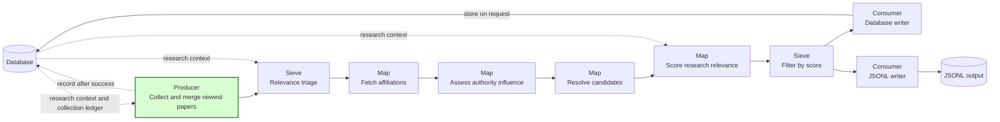
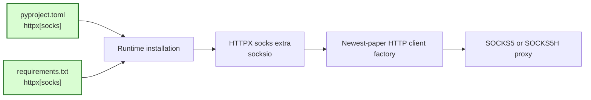

## SOCKS proxy support

### 1. Requirement analysis

HTTPX needs its `socks` extra to construct a client that uses a SOCKS proxy. The current runtime dependency declarations install HTTPX without this extra. `PySocks` supports Requests, but it does not supply the `socksio` package that HTTPX needs.

- **R1 — Complete runtime dependencies.** `pyproject.toml` and `requirements.txt` must declare `httpx[socks]` instead of `httpx`. Both supported installation paths must install the HTTPX SOCKS support. The declarations must use the HTTPX extra rather than a direct `socksio` dependency.
- **R2 — SOCKS client construction.** The HTTP client factory used by the newest-paper script must construct a client with a `socks5://` or `socks5h://` proxy URL. Client construction must not make a network request.
- **R3 — Regression protection.** Automated tests must cover the dependency declarations and SOCKS client construction. The tests must not need a live SOCKS server. Existing behavior must remain unchanged.

Expected behavior variants:

- **B1 — Package installation.** Installation from `pyproject.toml` includes the HTTPX SOCKS extra.
- **B2 — Requirements installation.** Installation from `requirements.txt` includes the same HTTPX SOCKS extra.
- **B3 — Local proxy name resolution.** A client accepts a `socks5://` proxy URL without a missing-package error.
- **B4 — Proxy-side name resolution.** A client accepts a `socks5h://` proxy URL without a missing-package error.
- **B5 — Existing collection behavior.** The existing test suite passes without changes to collection behavior.

### 2. Tests

- **T1 (R1, B1, B2) — Runtime dependency declarations.** Read `pyproject.toml` and `requirements.txt`. Assert that each file declares `httpx[socks]` and does not declare plain `httpx`.
- **T2 (R2, R3, B3, B4) — SOCKS client construction.** Construct and close the newest-paper HTTP client with local `socks5://` and `socks5h://` proxy URLs. Assert that construction succeeds without network access.
- **T3 (R3, B5) — Regression and quality checks.** Run the complete test suite and the configured format, import-order, lint, and type checks.

### 3. Implementation plan

#### 3.1 Implementation repos

- `anton-pershin/mourat`: management repository and implementation repository. No other repository requires a change.

#### 3.2 High-level design

The first diagram copies the newest-paper pipeline from the constitution. Green marks the producer whose HTTP client is covered by the regression test.

The second diagram shows the dependency and client-construction contract. Green marks the declarations changed in this spec.

#### 3.3 Todo list

1. [x] Write the tests.
2. [x] Run the focused tests and confirm that they fail.
3. [x] Add the HTTPX SOCKS extra to both runtime dependency declarations.
4. [x] Install the updated dependency in the test environment and run the focused tests.
5. [x] Run the complete test suite and quality checks.

#### 3.4 Modification summary

| File | Action |
|------|--------|
| `.internal/specs/34-socks-proxy-support-kiss-spec.md` | New: requirements, tests, and implementation plan |
| `pyproject.toml` | Modified: declare the HTTPX SOCKS extra |
| `requirements.txt` | Modified: keep the runtime requirements consistent with package metadata |
| `tests/test_socks_proxy.py` | New: dependency and SOCKS client-construction regression tests |
