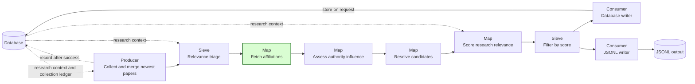
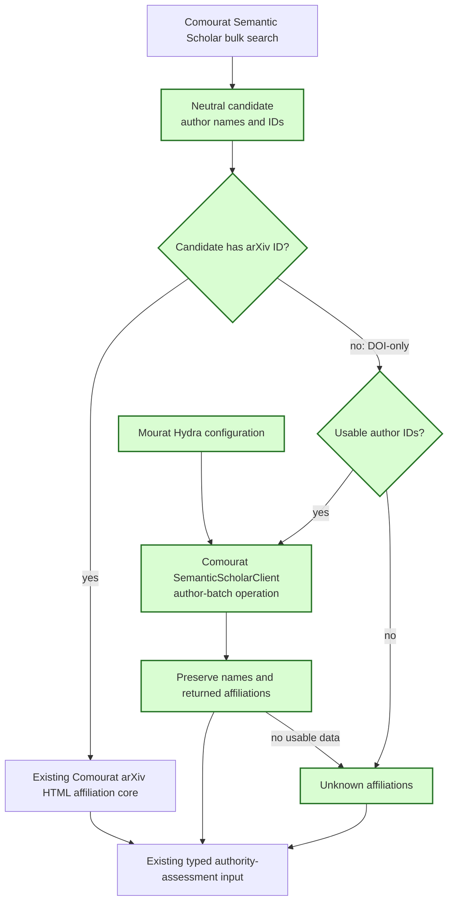

## Semantic Scholar author affiliations

This spec implements GitHub issue #36. It replaces the DOI-only unknown-affiliation rule in spec 28 FR9 and the corresponding no-request expectation in spec 28 AC6. Spec 28 records both replacements. The other requirements in spec 28 remain unchanged.

### 1. Requirement analysis

- **R1 — Author identifiers.** Comourat must retain the Semantic Scholar author IDs that bulk search returns with each author name. The neutral candidate must keep the IDs available for later affiliation collection without a second paper request. An author without an ID must not prevent collection of the other authors' affiliations.
- **R2 — One affiliation stage.** The newest-paper pipeline must retain its existing affiliation stage and its typed output to authority assessment. A candidate with an arXiv ID must use the existing arXiv HTML fetch. It must not use the Semantic Scholar fallback.
- **R3 — DOI-only fallback.** A DOI-only Semantic Scholar candidate must use its retained author IDs in one or more requests to the Semantic Scholar author-batch endpoint. Each request must use `POST /graph/v1/author/batch?fields=name,affiliations` and a JSON body with an `ids` array. Comourat must own this transport, its bounded retries, and its response conversion.
- **R4 — Available and missing data.** The affiliation stage must preserve all author names and make every non-empty affiliation list returned by Semantic Scholar available to authority assessment. Missing author records, missing IDs, null records, and empty affiliation lists must not hide data returned for other authors. A paper with no usable affiliation data must retain the internal `affiliations is None` state, which the assessor renders as `affiliations: "unknown"`. For partial data, an author without returned affiliations must have an `unknown` state while known institutions remain available. The implementation must not invent affiliations.
- **R5 — Authority-assessment input.** A DOI-only paper with Semantic Scholar affiliations must reach authority assessment with both its author names and those affiliations. The existing assessor and the remaining pipeline stages must keep their public contracts.
- **R6 — Configuration and failure behavior.** The Semantic Scholar fallback must use the existing optional API-key and proxy settings. It must use configured pacing and bounded backoff consistent with the newest-paper collector. A terminal transport or status failure after the Comourat request policy finishes must leave the paper's affiliations unknown and must not create a second affiliation pipeline.
- **R7 — Compatibility and observability.** Existing arXiv affiliation behavior, other paper pipelines, and legacy Semantic Scholar collection must remain compatible. Logs and monitoring must identify Semantic Scholar affiliation failures without exposing credentials.
- **R8 — Documentation and isolated verification.** The README, constitution design, and terminology must describe both affiliation sources. Automated tests must use mocked HTTP responses and must not require live provider access or credentials.

Expected behavior variants:

- **B1 — arXiv identity.** A candidate with an arXiv ID follows the existing arXiv HTML path, including its current failure behavior.
- **B2 — DOI-only data.** A DOI-only candidate receives the author names and non-empty Semantic Scholar affiliations.
- **B3 — Partial data.** Missing IDs, missing author records, null records, or empty affiliation lists affect only the corresponding authors. Returned affiliations for other authors remain available.
- **B4 — No usable data.** A DOI-only candidate with no author IDs or no returned affiliations retains the unknown state. The implementation sends no author-batch request when there are no IDs.
- **B5 — Bounded failure.** A failed DOI-only affiliation request follows the configured retry and backoff policy, then retains the unknown state.
- **B6 — Merged identity.** A candidate merged with an arXiv record uses only the arXiv HTML path even when Semantic Scholar supplied author IDs.

### 2. Tests

- **T1 (R1) — Author-ID retention.** Comourat tests verify that bulk-search conversion preserves author names and IDs, including missing IDs. A Mourat contract test verifies the merged Comourat revision through the real neutral candidate model.
- **T2 (R3, R4, B2, B3, B4) — Author-batch contract.** Comourat tests use mocked responses to verify the endpoint, HTTP method, requested fields, JSON ID body, name handling, affiliation conversion, partial data, null records, and empty data.
- **T3 (R6, B5) — Pacing and bounded failure.** Comourat tests verify the configured pacing, retry, and backoff behavior for author-batch requests. Mourat tests verify that terminal failure produces the existing unknown affiliation result.
- **T4 (R2, R3, R4, B1, B2, B3, B4, B6) — Affiliation-stage selection.** Adapter tests verify arXiv-first selection, DOI-only fallback, no request without IDs, partial results, per-author unknown states, and the paper-level unknown fallback. They also verify that no Semantic Scholar request occurs for an arXiv candidate.
- **T5 (R5) — Authority-assessment bridge.** A newest-paper pipeline test sends a DOI-only Semantic Scholar candidate through affiliation collection and verifies that the authority assessor receives its names and institutions. A second test verifies the unchanged unknown input when Semantic Scholar returns no affiliations.
- **T6 (R6) — Configuration.** Configuration tests verify API-key, proxy, pacing, retry, and backoff forwarding to the Comourat `SemanticScholarClient`.
- **T7 (R7, R8) — Regression and documentation.** Existing arXiv affiliation and legacy collector tests pass. Documentation checks cover the new source behavior. Spec 28 FR9 and AC6 record the replacement and remain consistent with this spec. The complete suite passes without live network access. Format, import-order, lint, and type checks on touched files introduce no new findings. The final report records unrelated findings that already exist on the base revision.

### 3. Implementation plan

#### 3.1 Implementation repos

- `anton-pershin/mourat`: management repository and implementation repository for the specification, one-stage selection policy, typed assessor bridge, configuration, monitoring, tests, and documentation.
- `anton-pershin/comourat`: implementation repository for author-ID retention and Semantic Scholar author-batch transport, retries, and neutral response conversion. PR #25 added `SemanticScholarClient.get_authors` and merged at commit `3272ce6d617df6009956d205dad361842aa7a46e`. PR #27 added publication-window `PaperCandidate.author_ids` and merged at commit `269a539982ab48328cfdf32c480f573140b1684f`. Mourat is integrated and reviewed against commit `269a539982ab48328cfdf32c480f573140b1684f`, which includes both changes.

#### 3.2 High-level design

The first diagram copies the newest-paper pipeline from the constitution. Green marks the modified affiliation stage.

The second diagram shows the responsibility boundary and the one-stage fallback. Green marks changed components.

Comourat owns Semantic Scholar transport and neutral data conversion. Mourat owns source selection, the single affiliation stage, failure reporting, and conversion to the existing assessor input. Retaining IDs during bulk conversion avoids one paper request for each DOI-only candidate.

#### 3.3 Todo list

1. [x] Write the tests.
2. [x] Run all the tests and ensure that they fail.
3. [x] Integrate the merged Comourat author-ID and author-batch change.
4. [x] Extend the existing affiliation stage with arXiv-first selection and the DOI-only Semantic Scholar fallback.
5. [x] Forward the API, proxy, pacing, retry, and backoff configuration and add failure monitoring.
6. [x] Update the README, constitution design, and terminology.
7. [x] Run focused tests, the complete suite, and all quality checks.
8. [x] Review the spec against the implementation, commit all changes, push the assigned branch, and open one pull request.

#### 3.4 Modification summary

| File | Action |
|------|--------|
| `.internal/specs/36-semantic-scholar-author-affiliations-kiss-spec.md` | New: requirements, tests, responsibility boundary, dependency commits, and implementation plan. |
| `.internal/specs/28-semantic-scholar-newest-papers-general-spec.md` | Modified: replace the DOI-only no-fetch rule and no-request acceptance expectation with references to spec 36. |
| `.internal/constitution-spec.md` | Modified: describe arXiv and Semantic Scholar affiliation sources in the newest-paper design. |
| `.internal/terminology.md` | Modified: include Semantic Scholar author data in the author-affiliation definition. |
| `mourat/collectors/arxiv_html_affiliations.py` | Modified: retain the single typed affiliation stage and add DOI-only source selection, author-batch fallback, partial-data conversion, and failure monitoring. |
| `mourat/data_models.py` | Modified: describe paper-level and per-author unknown affiliation states. |
| `mourat/scripts/collect_newest_papers.py` | Modified: describe both sources in the existing affiliation stage. |
| `config/arxiv_html_affiliations/default.yaml` | Modified: reuse the Semantic Scholar transport settings for the fallback. |
| `README.md` | Modified: document DOI-only affiliation fallback, configuration, and missing-data behavior. |
| `tests/test_newest_paper_pipeline.py` | Modified: cover one-stage source selection, partial data, unknown states, failures, and client configuration. |
| `tests/test_semantic_scholar_newest.py` | Modified: verify real Comourat author-ID retention and merge preservation. |
| `tests/test_newest_paper_script.py` | Modified: verify author-batch transport, configuration, and DOI-only authority-assessment input. |
| `tests/test_readme.py` | Modified: check both affiliation sources in the newest-paper documentation. |
| Comourat model, collector, client, and test files | Modified in merged PRs #25 and #27: retain author IDs and implement the author-batch operation. |
