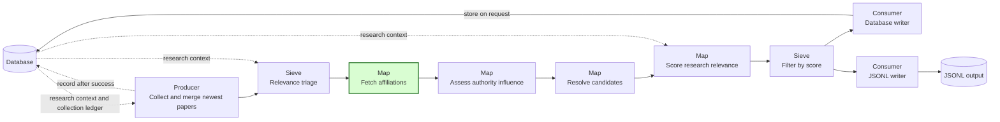
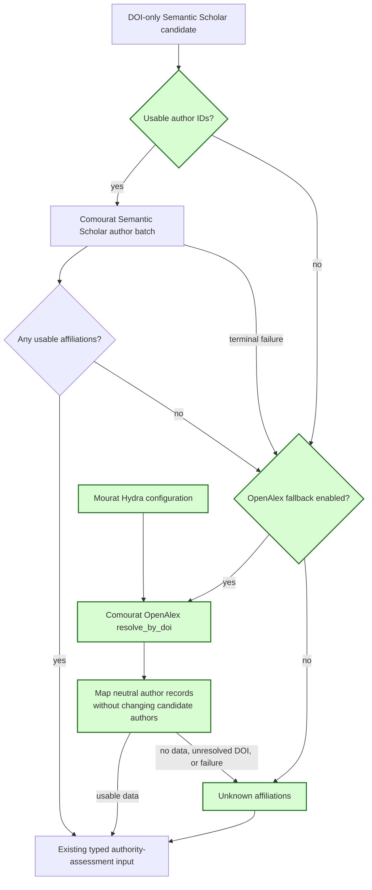

## OpenAlex affiliation fallback

This spec implements GitHub issue #38. It extends the DOI-only affiliation behavior in specs 28 and 36. The other requirements in those specs remain unchanged.

### 1. Requirement analysis

- **R1 — One affiliation stage.** The newest-paper pipeline must retain its existing affiliation stage and typed output to authority assessment. A candidate with an arXiv ID must use only the existing arXiv HTML route. The change must not add another pipeline or change the assessor contract.
- **R2 — Semantic Scholar first.** A DOI-only Semantic Scholar candidate must first use the author-batch behavior from spec 36 when usable author IDs exist. Any usable Semantic Scholar affiliations, including a partial result, must remain unchanged and must prevent an OpenAlex request for that paper.
- **R3 — OpenAlex fallback.** When Semantic Scholar supplies no usable affiliations because IDs are absent, the response has no usable affiliations, or the request fails, an enabled OpenAlex source must resolve the candidate DOI through Comourat `OpenAlexClient.resolve_by_doi`. Each candidate must cause at most one such DOI-resolution call. Comourat must own transport, bounded retries, and response conversion. Mourat must not add OpenAlex HTTP handling.
- **R4 — Names and partial results.** The candidate's existing author list must remain unchanged. OpenAlex `PaperRecord.author_records` must supply available author names and affiliations to the existing affiliation mapping. Exact name matches must use the candidate's retained names. Otherwise, the OpenAlex display name must remain visible with its affiliations. Known institutions must survive when other authors have no data. Authors without data must have an `unknown` state when at least one author has usable data. The implementation must not invent or merge different affiliation strings.
- **R5 — Unknown only after enabled sources.** A paper must retain `affiliations is None` only when no enabled source supplies usable data. An unresolved OpenAlex DOI, empty author records, empty affiliations, or a terminal OpenAlex failure must leave the paper unknown without hiding other papers' results. The authority assessor must render this state as `affiliations: "unknown"`.
- **R6 — Configuration and bounded requests.** Hydra configuration must provide an OpenAlex enable switch, user agent, optional API key, timeout, retry count, backoff, and request pacing. The default must enable the fallback. The existing `OPENALEX_API_KEY` setting must supply the key. Each DOI lookup must use the Comourat client's configured bounded request policy.
- **R7 — Logs and monitoring.** Logs and monitoring must distinguish Semantic Scholar and OpenAlex results and failures. Reports must include fallback attempts, papers with OpenAlex affiliations, unresolved or empty results, terminal failures, and the final number of unknown papers. Logs must not expose credentials.
- **R8 — Compatibility and documentation.** Existing arXiv behavior, other pipelines, and legacy Semantic Scholar collection must remain compatible. The README, constitution design, terminology, and cross-references in specs 28 and 36 must describe the three sources and the fallback policy. Automated tests must use mocked responses and must not require live provider access or credentials.

Expected behavior variants:

- **B1 — arXiv identity.** A candidate with an arXiv ID uses only arXiv HTML, even when it also has a DOI and Semantic Scholar provenance.
- **B2 — Semantic Scholar data.** Full or partial Semantic Scholar affiliations are preserved, and OpenAlex is not called.
- **B3 — Semantic Scholar has no usable data.** Missing IDs, empty affiliations, or terminal failure lead to one OpenAlex DOI lookup when the fallback is enabled.
- **B4 — OpenAlex data.** Full or partial OpenAlex affiliations reach authority assessment with retained author names and available institutions.
- **B5 — No source data.** An unresolved DOI, no usable OpenAlex affiliations, or terminal OpenAlex failure leaves affiliations unknown and does not stop other candidates.
- **B6 — Disabled fallback.** No OpenAlex request occurs when `openalex_enabled` is false.
- **B7 — Other DOI-only candidates.** A DOI-only candidate without Semantic Scholar provenance keeps its existing pass-through behavior and uses neither fallback source.

### 2. Tests

- **T1 (R2, R3, R4, B2, B3, B4) — Source order and fallback.** Adapter tests cover full and partial Semantic Scholar results with no OpenAlex call. They also cover OpenAlex lookup after missing IDs, empty Semantic Scholar affiliations, and Semantic Scholar failure. Assertions cover the DOI argument, one call per candidate, retained names, known affiliations, and per-author unknown states.
- **T2 (R4, R5, B4, B5) — OpenAlex result variants.** Adapter tests cover institution names and raw strings from real neutral author records, partial author data, an unresolved DOI, empty author records, and empty affiliations. They verify paper-level and per-author unknown states without loss of other authors' data.
- **T3 (R3, R5, R7, B3, B5) — Bounded failure and observability.** Mocked terminal OpenAlex failures retain unknown affiliations and produce provider-specific logs and monitoring. Tests verify fallback attempt, success, unresolved, failure, and final-unknown counts. Comourat's merged tests cover the bounded transport attempts.
- **T4 (R1, R3, R6, B1, B6, B7) — Selection and configuration.** Tests verify arXiv-only routing, disabled OpenAlex, non-Semantic-Scholar pass-through, and forwarding of the user agent, API key, timeout, retry, backoff, and pacing settings. Hydra tests cover defaults and overrides.
- **T5 (R1, R4, R5, R8) — Authority-assessment bridge.** A newest-paper pipeline test uses the real Comourat OpenAlex conversion with mocked HTTP. It verifies that OpenAlex institutions and raw strings reach authority assessment when Semantic Scholar returns empty affiliation lists. A no-data variant verifies the unchanged unknown input.
- **T6 (R8) — Regression and documentation.** Existing affiliation, collector, writer, and pipeline tests pass. Documentation checks cover OpenAlex fallback, configuration, and missing-data behavior. Specs 28 and 36 refer to this spec where their old terminal unknown rules change. The complete suite passes without live network access. Format, import-order, lint, and type checks on touched files introduce no new findings.

### 3. Implementation plan

#### 3.1 Implementation repos

- `anton-pershin/mourat`: management repository and implementation repository for this spec, source selection, typed assessor input, configuration, monitoring, tests, and documentation.
- `anton-pershin/comourat`: merged dependency. Issue #28 and PR #29 added `PaperRecord.author_records` and OpenAlex authorship conversion. The dependency merged at commit `136ebf7233acb457499795e656b7312d0a73baf8`. Mourat integrates that neutral contract and adds no provider transport.

#### 3.2 High-level design

The first diagram copies the newest-paper pipeline from the constitution. Green marks the modified affiliation stage.

The second diagram shows the selected paper-level fallback. Green marks the new OpenAlex path and changed source-selection logic.

Comourat owns both provider clients and neutral records. Mourat owns source order and conversion to the existing assessor input. OpenAlex runs only when Semantic Scholar has no usable data for the whole paper. This design avoids a parallel-source merge policy and avoids an OpenAlex request when Semantic Scholar already supplies full or partial data.

#### 3.3 Todo list

1. [ ] Write the tests.
2. [ ] Run the focused tests and ensure that they fail.
3. [ ] Integrate the merged Comourat OpenAlex neutral author records.
4. [ ] Extend the existing affiliation stage with the OpenAlex fallback and monitoring.
5. [ ] Add Hydra configuration and update the README, constitution, terminology, and earlier specs.
6. [ ] Run focused tests, the complete suite, and all quality checks.
7. [ ] Review the spec against the implementation, commit all changes, push the assigned branch, and open one draft pull request.

#### 3.4 Modification summary

| File | Action |
|------|--------|
| `.internal/specs/38-openalex-affiliation-fallback-kiss-spec.md` | New: requirements, tests, selected fallback design, dependency commit, and implementation plan. |
| `.internal/specs/28-semantic-scholar-newest-papers-general-spec.md` | Modified: refer to the OpenAlex fallback in downstream behavior and authority-assessment acceptance criteria. |
| `.internal/specs/36-semantic-scholar-author-affiliations-kiss-spec.md` | Modified: identify OpenAlex as the next source when Semantic Scholar has no usable data or fails. |
| `.internal/constitution-spec.md` | Modified: describe arXiv HTML, Semantic Scholar, and OpenAlex affiliation sources in the newest-paper design. |
| `.internal/terminology.md` | Modified: include OpenAlex paper metadata and the source order in the author-affiliation definition. |
| `mourat/collectors/arxiv_html_affiliations.py` | Modified: add the configured OpenAlex fallback, neutral-record conversion, failure handling, logs, and monitoring. |
| `mourat/scripts/collect_newest_papers.py` | Modified: describe all three sources in the existing affiliation stage. |
| `config/arxiv_html_affiliations/default.yaml` | Modified: add OpenAlex enable, identity, API, timeout, retry, backoff, and pacing settings. |
| `README.md` | Modified: document source order, fallback behavior, configuration, and final unknown states. |
| `tests/test_newest_paper_pipeline.py` | Modified: cover source selection, OpenAlex full and partial data, failures, disabled fallback, and client configuration. |
| `tests/test_newest_paper_script.py` | Modified: verify real Comourat OpenAlex conversion and DOI-only authority-assessment input. |
| `tests/test_readme.py` | Modified: check the documented OpenAlex fallback and final unknown behavior. |
