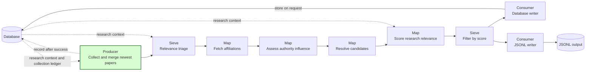
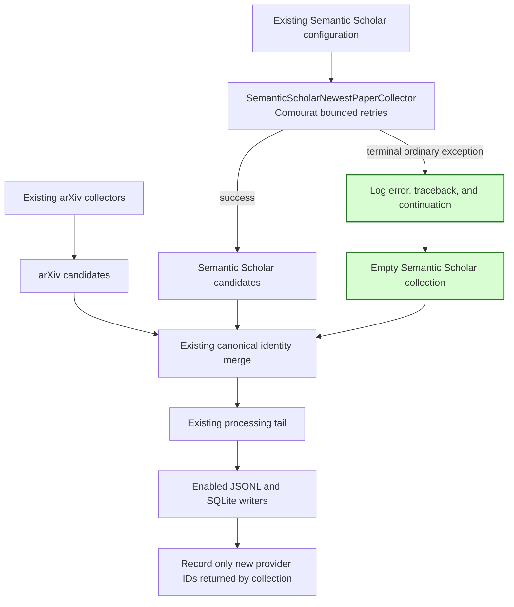

## Continue newest-paper collection after Semantic Scholar failure

This spec implements GitHub issue #41. It supersedes the terminal source-failure policy in spec 28 FR5 and AC3. The other requirements in spec 28 remain unchanged.

### 1. Requirement analysis

- **R1 — Semantic Scholar failure containment:** An ordinary exception raised during `SemanticScholarNewestPaperCollector` invocation must not abort the newest-paper pipeline. Comourat must retain ownership of transport and bounded retries. Mourat must catch the terminal exception at the collector-invocation boundary and use an empty Semantic Scholar `PaperCandidateCollection` for that run. `KeyboardInterrupt`, `SystemExit`, and other `BaseException` subclasses are outside this fallback.
- **R2 — Useful error observability:** The fallback must log at error level with the exception traceback. The log must identify Semantic Scholar newest-paper collection and state that the pipeline will continue with candidates from other sources. Existing collector logs retain the publication window and elapsed-time context. The new log must not add credentials or credential values.
- **R3 — Continue with available candidates:** When arXiv collection succeeds and Semantic Scholar collection fails, the pipeline must merge the arXiv candidates with the empty Semantic Scholar collection. The resulting candidates must pass through the existing relevance triage, affiliation, authority, conversion, scoring, filtering, and enabled writer stages. A two-source run with a failed Semantic Scholar source must therefore produce the same arXiv-only downstream result as a successful run for which Semantic Scholar returns no candidates.
- **R4 — Collection-ledger safety:** A failed Semantic Scholar collection must contribute no new provider paper IDs to the merge result or collection ledger. Existing ledger entries must remain unchanged. Successfully written arXiv candidates do not create Semantic Scholar ledger entries. A later run can retry the failed Semantic Scholar window through the existing reference-date and backfill controls.
- **R5 — Scope and compatibility:** The change must not alter Comourat retries, arXiv collection, source-selection validation, candidate identity rules, writer contracts, or other pipelines. Failures in arXiv collection and downstream processing or writing must retain their existing propagation behavior. No new configuration or cross-repository change is required.

Expected behavior variants:

- **B1 — Semantic Scholar succeeds:** Existing one-source and two-source behavior remains unchanged, including provider-ID recording after all enabled writers finish.
- **B2 — Semantic Scholar fails with arXiv available:** The error is logged, the merge contains the successful arXiv candidates, downstream stages and enabled writers run, and no new Semantic Scholar provider IDs are recorded.
- **B3 — Semantic Scholar is the only selected source and fails:** The collector boundary returns an empty collection and the existing empty-candidate pipeline path continues without recording new provider IDs.
- **B4 — Another stage fails:** Source-selection, arXiv collection, processing, and writer failures are not hidden by the Semantic Scholar fallback.

### 2. Tests

- **T1 (R1, R2, R3, R4, B2) — Terminal HTTP 429 with successful arXiv output:** Run the full newest-paper script with both sources enabled, successful mocked arXiv RSS and affiliation responses, mocked LLM responses, and a mocked Semantic Scholar bulk-search response that exhausts its configured retries with HTTP 429. Verify that the run does not raise, the error log identifies Semantic Scholar and continuation and includes the HTTP 429 traceback, the merge reports arXiv candidates and zero Semantic Scholar candidates, and the arXiv paper reaches JSONL and SQLite. Seed the ledger with an existing ID and verify that it remains the only entry.
- **T2 (R1, R3, R4, B3) — Empty fallback collection:** At the Semantic Scholar source boundary, inject a terminal ordinary collector exception. Verify one empty `PaperCandidateCollection`, an error log with a traceback and continuation context, and no provider IDs available for recording. Verify that collector construction remains outside the fallback so configuration and construction errors are not silently converted into an empty result.
- **T3 (R5, B1) — Successful-source regression:** Existing Semantic Scholar success, two-source merge, ledger, writer, and source-selection tests must pass without live network access. Successful Semantic Scholar candidates must still be written and recorded.
- **T4 (R5, B4) — Other failures retain their policy:** Existing arXiv collector tests and newest-paper tests for failures before writers finish and database-writer failure must pass. These failures must not become Semantic Scholar fallback cases.
- **T5 (R2, R3, R4, R5) — Documentation and complete checks:** README checks must cover continuation with arXiv candidates and the absence of new Semantic Scholar ledger IDs after source failure. The complete automated suite and formatting checks must pass. Import-order, lint, and type checks on touched files must pass without new findings. Existing findings in untouched files are outside this increment.

### 3. High-level solution design

#### 3.1 Newest-paper pipeline

This diagram copies the newest-paper design from the constitution. Green marks the modified producer.

#### 3.2 Source-boundary fallback

Green marks the new terminal-failure path. All other components retain their current responsibilities.

The fallback belongs in Mourat's `_collect_semantic_scholar` source adapter, around the configured collector call. Construction stays outside the `try` block. The adapter returns an empty collection after it logs a terminal invocation failure. `_collect_and_merge` and the downstream pipeline need no failure-specific branch. The existing merge produces an empty `new_semantic_scholar_ids` list for the failed source, so the final ledger operation cannot mark unreturned Semantic Scholar papers as processed.

#### 3.3 Todo list

1. [x] Add spec 41 and align spec 28 FR5 and AC3 with the new source-failure policy.
2. [x] Add the HTTP 429 full-pipeline and source-boundary regression tests and confirm that they fail before implementation.
3. [x] Add the narrow Semantic Scholar invocation fallback and contextual error log.
4. [x] Document continuation, ledger safety, and recovery in the README and documentation tests.
5. [x] Run focused tests, the complete suite, formatting, import-order, lint, and type checks.
6. [x] Review the spec against the implementation, commit and push the assigned branch, and open one draft pull request.

#### 3.4 Modification summary

| File | Action |
|------|--------|
| `.internal/specs/41-continue-after-semantic-scholar-failure-kiss-spec.md` | New: failure-isolation requirements, tests, selected design, and implementation plan. |
| `.internal/specs/28-semantic-scholar-newest-papers-general-spec.md` | Modified: replace terminal run-failure propagation with the spec 41 continuation policy while retaining bounded retries and ledger safety. |
| `mourat/scripts/collect_newest_papers.py` | Modified: contain Semantic Scholar collector invocation failures and return an empty source collection after contextual error logging. |
| `tests/test_newest_paper_script.py` | Modified: cover terminal HTTP 429 continuation through writers, empty fallback behavior, logs, and ledger safety. |
| `README.md` | Modified: document degraded two-source runs and Semantic Scholar retry behavior. |
| `tests/test_readme.py` | Modified: verify the documented continuation and ledger behavior. |
