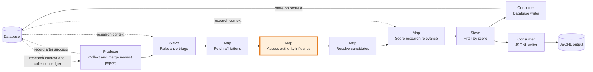
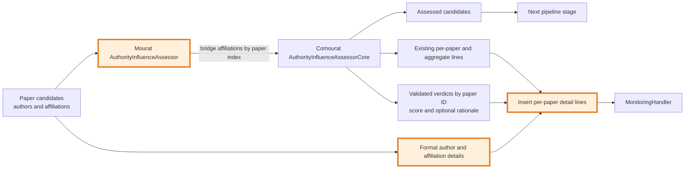

## Per-paper authority observability

### 1. Requirement analysis

This spec implements approved GitHub issue #43. It uses the optional verdict rationale and structured assessment result supplied by `anton-pershin/comourat#30` and merged in `anton-pershin/comourat#31`.

**R1 — Author and affiliation details.** For every paper in the `AuthorityInfluenceAssessor` monitoring report, retain the existing identifier, title, and score or unassessable reason, and add the paper's authors with their affiliations. Preserve candidate author order. List every known affiliation for each author. Mark affiliations as unknown when no usable value is available, and mark the author list as unknown when the candidate has no authors.

**R2 — Score explanations.** For every successfully scored paper, including a paper with score 0, add the optional `rationale` from the `AuthorityVerdict` returned by `AuthorityInfluenceAssessorCore.assess()`. Match the verdict to the candidate through the existing `paper_<index>` ID. If the validated verdict has no rationale or has a blank rationale, report `Rationale: not provided`; do not change the score or make the paper unassessable.

**R3 — Existing failure behavior.** For an unassessable paper, retain its cause-specific reason and add its author and affiliation details. Do not add a score-explanation line because no validated verdict exists. Preserve fail-open scores, retries, follow-up behavior, batching, and all aggregate summary lines.

**R4 — Monitoring ownership.** Keep the change in the `mourat` Function adapter. Do not add monitoring behavior to `comourat`, persist rationales on paper candidates, or change pipeline outputs other than the authority-assessment monitoring text.

Expected behavior variants:

- **B1 — Explained score.** A scored paper has authors, known affiliations, and a rationale; all appear next to its existing assessment line.
- **B2 — Valid zero score.** A validated score-0 verdict receives the same author, affiliation, and rationale details as any other scored paper.
- **B3 — Missing affiliations or authors.** Unknown affiliations and an empty author list are explicit in monitoring and do not affect assessment.
- **B4 — Missing optional rationale.** A scored verdict without a rationale remains scored and reports `Rationale: not provided`.
- **B5 — Unassessable paper.** A missing or failed verdict keeps its existing reason, includes author and affiliation details, and has no rationale line.

### 2. Tests

- **T1 — Detailed scored papers.** Covers R1, R2, R4, B1, and B2. Assess two papers with different rationales. Give one paper several authors and affiliations and a score of 0; give the other paper no affiliation data. Assert the exact adjacent assessment, author, and rationale lines, including author order and all affiliations.
- **T2 — Optional rationale and empty authors.** Covers R1, R2, B3, and B4. Assess papers with no authors and valid verdicts with an omitted or blank rationale. Assert `Authors: unknown`, `Rationale: not provided`, and retention of the scores.
- **T3 — Unassessable details.** Covers R1, R3, B3, and B5. Omit a paper's verdict. Assert its existing unassessable reason, its author details with unknown affiliations, no rationale line, and the unchanged aggregate summary.
- **T4 — Regression coverage.** Covers R1 through R4 and all variants. Run the authority-assessor tests and the complete test suite. Confirm existing score matching, batch splitting, retries, stable identifiers, zero-score handling, and summary retention remain valid. Run formatting, import-order, lint, and type checks for the touched code.

### 3. Implementation plan

#### 3.1 Implementation repos

- `anton-pershin/mourat` — specification, adapter implementation, and tests.
- `anton-pershin/comourat` — completed external dependency only; no change in this spec.

#### 3.2 High-level design

The first diagram copies the newest-paper pipeline from the constitution. Orange marks the modified authority-influence component. Other stages and their relationships remain unchanged.

The component diagram shows the extended adapter data flow. The core supplies the existing summary lines and validated verdicts. The adapter adds candidate-owned author details and verdict-owned rationales to the monitoring text.

The adapter consumes the three-value `assess()` result. It inserts an indented `Authors:` line after every existing per-paper assessment line. For a paper with a validated verdict, it also inserts an indented `Rationale:` line. It leaves the aggregate lines and all assessment decisions unchanged.

#### 3.3 Todo list

1. [x] Add the specification and focused monitoring tests.
2. [x] Run the focused tests before the adapter change and confirm failure.
3. [x] Consume the structured verdict result and add per-paper author, affiliation, and rationale lines.
4. [x] Run focused tests and fix failures.
5. [x] Run the complete test suite and repository quality checks.
6. [x] Push the assigned branch and open a draft pull request linked to issue #43.

#### 3.4 Modification summary

| File | Action |
|------|--------|
| `.internal/specs/43-per-paper-authority-observability-kiss-spec.md` | New: requirements, tests, and component design for detailed authority monitoring. |
| `mourat/processors/authority_influence.py` | Modified: consume validated verdicts and enrich per-paper monitoring lines. |
| `tests/test_newest_paper_pipeline.py` | Modified: cover authors, affiliations, rationales, missing optional data, and unassessable papers. |
