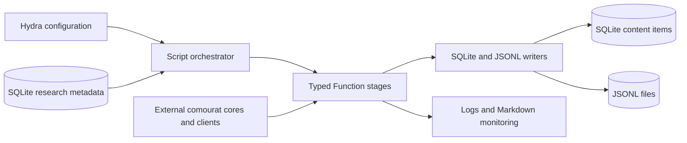

# mourat

`mourat` is a configurable Python toolkit for research-content collection. It collects
papers, Reddit posts, and Hacker News stories. Its pipelines can assess influence,
enrich content, score research relevance with LLMs, filter the results, and write them
to SQLite or JSONL files. It also provides calibration, retrieval, query-generation,
and candidate-topic assessment tools.

The `mourat` package contains orchestration, typed pipeline stages, database code, and
writers. The external `comourat` package provides reusable source clients, neutral
models, collectors, and web-enhancement cores.

## Getting started

Python 3.12 or later is required.

1. Create and activate a virtual environment. For example:

   ```bash
   conda create -n mourat python=3.13
   conda activate mourat
   ```

2. Install the runtime dependencies:

   ```bash
   pip install -r requirements.txt
   ```

   For development, also install the test and quality-check dependencies:

   ```bash
   pip install -r requirements_dev.txt
   ```

3. Set the environment variables required by the selected script. Create and populate
   the SQLite database before you run a collection or retrieval script.

4. Run a script as a module from the repository root:

   ```bash
   python -m mourat.scripts.collect_newest_papers
   ```

Both `requirements.txt` and `pyproject.toml` require `pydantic-ai` 2.64.0 or later.
They also pin Comourat to commit
`d82a29f87b858024615f8f56c4059c11b043bdd9`. Keep this full commit in both dependency
declarations. If you select a newer Comourat revision, review its contracts and run the
complete test suite.

## Configuration and outputs

Each script uses one main file in `config/`. The file name is
`config_<script_name>.yaml`. Hydra composes this file with component configurations
from the subdirectories of `config/`.

`config/user_settings/user_settings.yaml` reads these environment variables:

| Variable | Use |
|----------|-----|
| `MOURAT_DB_PATH` | Path to an existing SQLite database. Active collection and retrieval scripts use this value by default. |
| `CAILA_API_KEY` | API key for the default Caila-hosted LLM configurations. |
| `OPENALEX_API_KEY` | Optional OpenAlex premium API key. |
| `MOURAT_REDDIT_CLIENT_ID` | Reddit application client ID for Reddit collection and calibration. |
| `MOURAT_REDDIT_CLIENT_SECRET` | Reddit application client secret. |
| `MOURAT_HYDRA_PATH` | Optional root for run outputs. The default is `/tmp/mourat_hydra`. |

Some component configurations read additional optional variables:

- `SEMANTIC_SCHOLAR_API_KEY` selects authenticated Semantic Scholar access for newest-paper
  collection and for a configured Semantic Scholar graph client.
- `SEMANTIC_SCHOLAR_PROXY` configures a proxy for Semantic Scholar graph clients, paper
  discovery, Reddit web enrichment, and Hacker News content fetching where applicable.
- `ARXIV_PROXY` configures a proxy for arXiv PDF verification.

The default LLM configurations use Caila. The configurations in `config/llm/` show the
available alternatives, including an OpenAI-compatible local endpoint. Select or edit
the LLM configuration for each model role in the main script configuration.

Use Hydra overrides to change a setting without editing a file. For example:

```bash
python -m mourat.scripts.collect_newest_papers \
  db_path=/path/to/mourat.db \
  score_threshold=70 \
  db_writer.enabled=true \
  jsonl_writer.enabled=true
```

The collection scripts require an existing database because they read research
metadata from it. This requirement also applies when the database writer is disabled.
The paper pipelines use configured metadata IDs. The Reddit and Hacker News pipelines
load all research questions, technical challenges, research topics, and constraints
from the database.

### Writers and run files

The active pipelines have independent `db_writer.enabled` and `jsonl_writer.enabled`
controls. These are their default states:

| Script | SQLite writer | JSONL writer |
|--------|---------------|--------------|
| `collect_newest_papers.py` | Disabled | Enabled |
| `collect_influential_papers_from_scratch.py` | Disabled | Enabled |
| `collect_influential_papers_from_seeds.py` | Disabled | Enabled |
| `collect_posts.py` | Disabled | Disabled |
| `collect_hn_posts.py` | Enabled | Enabled |

The default JSONL paths are in the run's result directory. Each JSONL writer opens its
output file for writing, so select a new path if you must preserve an existing file in
the same directory. Database-writing behavior depends on the content type: paper
writers create or update items and their relevance links, while post writers skip
items that already exist.

Hydra writes run files below `MOURAT_HYDRA_PATH`, grouped by date and time. The default
monitoring handler writes one Markdown file per pipeline step to the result directory.
Logs show step starts, completion times, failures, and item counts where the component
provides them.

## Active collection pipelines

### `collect_newest_papers.py`

Collects papers from arXiv, Semantic Scholar, or both. The default `sources` list enables
both producers. Use `sources=[arxiv]` for arXiv only or `sources=[semantic_scholar]`
for Semantic Scholar only. An empty, duplicate, or unknown source selection is an error.

For arXiv, the script collects new submissions from all RSS feeds under `feeds`. With
`only_new_submissions: true`, replacements and cross-listings are excluded.

For Semantic Scholar, `semantic_scholar_newest.queries` supplies one or more strict
keyword queries. The collector uses publication date ranges, not the date when Semantic
Scholar indexed a paper. Its default schedule uses a 30-day lag and one-day request
strides. It also runs a 90-day backfill on the first run and every seven days. The lag,
stride, backfill, request delays, retries, and optional result limit are configurable.
The default null result limit follows every continuation token.

**Pipeline:**

`ArxivPaperCollector` and/or `SemanticScholarNewestPaperCollector` →
`PaperCandidateDeduplicator` → `RelevanceTriageClassifier` →
`ArxivHtmlAffiliationFetcher` → `AuthorityInfluenceAssessor` →
`CandidateToResolvedConverter` → `PaperContentItemScorer` → `PaperScoreFilter` →
`JsonlWriter` and/or `ContentItemDbWriter`.

- The deduplicator compares normalized arXiv and DOI identities. The arXiv record is
  primary when both sources find a paper. Provenance is combined. Semantic Scholar-only
  papers must have a DOI; records without one are excluded before triage.
- Relevance triage is a batched boolean filter over research questions, technical
  challenges, and research topics. Constraints do not participate in triage.
- The affiliation fetcher reads arXiv HTML for records with an arXiv ID. Affiliations stay
  unknown for DOI-only records. The authority assessor gives an LLM-based influence score
  from 0 to 100.
- The scorer gives a relevance score from 0 to 100 for each configured research
  attribute. Constraints contribute to the filtering score. At least one research
  question, technical challenge, or research topic ID must resolve.
- SQLite stores a seen-paper ledger and a cursor for each Semantic Scholar query. Seen
  papers do not repeat triage, including papers rejected earlier. The script commits this
  state after all downstream stages and enabled writers succeed. A failed run does not
  advance the cursor or the ledger, so a retry can process the same papers again.
- Paper storage uses arXiv identity first, DOI second, and a title slug only when neither
  identifier is available. Persistent aliases prevent a DOI-only row and a later arXiv
  record from becoming two rows. The JSONL writer can skip existing papers through the
  same identity lookup when `jsonl_writer.skip_existing` is enabled.

**Configuration:** `config/config_collect_newest_papers.yaml` controls sources and feeds.
`config/semantic_scholar_newest/default.yaml` controls Semantic Scholar queries, schedule,
pagination, and HTTP behavior. Set `SEMANTIC_SCHOLAR_API_KEY` for authenticated access.
The main configuration also controls research-attribute IDs, model roles, relevance
threshold, and writers.

### `collect_influential_papers_from_scratch.py`

Discovers papers for configured research needs without requiring existing content
items as seeds. An LLM agent uses web search to propose candidates.

**Pipeline:**

`PaperDiscoverer` → `PaperResolver` → `InfluenceAssessor` → `ArxivPdfVerifier` →
`PaperContentItemScorer` → `PaperScoreFilter` → `ContentItemDbWriter` and/or
`JsonlWriter`.

- Resolution obtains canonical metadata and drops unresolved candidates.
- Influence assessment uses field-weighted citation impact when available and falls
  back to citations per year. Breakpoints normalize the value to a score from 0 to
  100.
- PDF verification records a verified arXiv PDF URL or an empty URL with a reason.
- Relevance scores range from 0 to 100. Constraints contribute to the filtering score.
  The score filter applies the configured threshold.
- The JSONL writer can optionally skip papers already in the database when
  `jsonl_writer.skip_existing` is enabled.

**Configuration:** `config/config_collect_influential_papers_from_scratch.yaml`
controls research-attribute IDs, the OpenAlex graph client, discovery and scoring
models, component budgets, the relevance threshold, and writers.

### `collect_influential_papers_from_seeds.py`

Starts with content items already stored in SQLite and expands their paper graph. The
seed retrieval uses configured research-question and technical-challenge links.
`seed_content_item_ids` can restrict the retrieved set. Every explicit ID must match a
retrieved item.

**Pipeline:**

`SeedResolver` → `SeedExpander` → `PaperResolver` → `InfluenceAssessor` →
`InfluenceFloorFilter` → `ArxivPdfVerifier` → `PaperContentItemScorer` →
`PaperScoreFilter` → `ContentItemDbWriter` and/or `JsonlWriter`.

- Seed expansion combines forward citations, title-based relevance search, and backward
  references. It applies per-generator budgets, removes duplicate work IDs, and keeps
  provenance.
- Expansion and canonical resolution can use different graph providers.
- The influence-floor stage uses a configured percentile of the resolved seeds'
  normalized influence values. A null percentile disables the threshold comparison.
- Relevance scores range from 0 to 100. The score filter uses the highest eligible
  relevance score as the filtering score.

**Configuration:** `config/config_collect_influential_papers_from_seeds.yaml` controls
seed selection, expansion and resolution providers, generator budgets, the influence
floor, scoring attributes, the relevance threshold, and writers.

### `collect_posts.py`

Collects recent Reddit posts from configured subreddits. It removes low-influence and
low-information posts, adds web context, and scores research relevance.

**Pipeline:**

`RedditPostCollector` → `PostInfluenceAssessor` → `PostInfluenceFilter` →
`HeuristicSlopFilter` → `PostSlopClassifier` → `SlopFilter` → `WebEnricher` →
`PostContentItemScorer` → `PostScoreFilter` → `PostContentItemDbWriter` and/or
`PostJsonlWriter`.

- Influence assessment and filtering run only when `post_influence.enabled` is true.
  Each subreddit has a reference score for normalization.
- The heuristic filter applies deterministic rules before the LLM slop classifier.
- Web enrichment can search the web and fetch pages. Enrichment failure removes the
  affected post from the enriched output. Timeouts, retries, and tool budgets are
  configurable.
- The scorer loads all research metadata from SQLite. Relevance scores range from 0 to
  100. Constraints are scored but do not contribute to the filtering score.
- Both writers are disabled by default. Enable at least one writer if content output is
  required.

**Configuration:** `config/config_collect_posts.yaml` controls subreddits and time
windows through the collector group, influence references, slop handling, enrichment,
scoring, and writers. Reddit credentials come from the environment.

### `collect_hn_posts.py`

Collects Hacker News stories through the Algolia API. It fetches and summarizes linked
articles before relevance scoring. No Hacker News credentials are required.

**Pipeline:**

`HNPostCollector` → `HNInfluenceAssessor` → `HNInfluenceFilter` →
`HNContentFetcher` → `HNSummarizer` → `HNContentItemScorer` → `HNScoreFilter` →
`HNContentItemDbWriter` and/or `HNPostJsonlWriter`.

- The collector applies a time window, tags, a server-side minimum-points filter, and a
  result limit.
- Influence assessment and filtering run only when `hn_influence.enabled` is true. One
  reference level normalizes points to an influence score from 0 to 100.
- The fetcher drops posts with unavailable URLs or empty extracted content. The
  summarizer retries invalid LLM output and drops a post after retries are exhausted.
- Relevance scoring uses the story title and compact summary, not the full fetched
  text. Constraints do not contribute to the filtering score.
- Both writers are enabled by default.

**Configuration:** `config/config_collect_hn_posts.yaml` controls collection,
influence, fetching, summarization, scoring, and writers.

## Retrieval and auxiliary scripts

### `retrieve_content.py`

Runs a read-only SQLite query and prints a Rich table of item IDs, names, influence
scores, and URLs. It does not run an LLM or a collection pipeline.

**Configuration:** `config/config_retrieve_content.yaml` supplies the database path,
query type, query arguments, and optional score limits.

The supported query types and their main arguments are:

| `query_type` | Main argument | Optional score argument |
|--------------|---------------|-------------------------|
| `keywords` | `keyword_query` | `min_relevance_score` |
| `research_question` | `research_question_id` | `min_relevance_score` |
| `technical_challenge` | `technical_challenge_id` | `min_relevance_score` |
| `research_topic` | `research_topic_id` | `min_relevance_score` |
| `influence_score` | `min_influence_score` | `max_influence_score` |

For example:

```bash
python -m mourat.scripts.retrieve_content \
  db_path=/path/to/mourat.db \
  query_type=keywords \
  keyword_query="transformer"
```

Keyword search uses SQLite FTS5 and supports Boolean operators and prefix terms.
Research-attribute queries follow the relevance links written by collection pipelines.
Influence-score queries select a score range.

### `calibrate_subreddit_stats.py`

Measures recent upvote scores for each configured subreddit. It writes count, median,
mean, p10, p90, maximum, and configured percentiles to a YAML file. It supports
overwrite and append modes and reports insufficient samples. It uses no database and
no LLM.

Use the results to select `post_influence.references` values for `collect_posts.py`.
Copy the selected values into the pipeline configuration manually.

**Configuration:** `config/config_calibrate_subreddit_stats.yaml` controls subreddits,
time window, sample limits, percentiles, output path, and write mode. Reddit
credentials are required.

### `calibrate_hn_stats.py`

Samples Hacker News stories published between 48 and 24 hours before the run. This
window gives stories time to accumulate points. It writes count, median, mean, p10,
p90, maximum, and configured percentiles to a YAML file. It supports overwrite and
append modes and reports insufficient samples. It uses no database and no LLM.

Use the results to select the collector's raw `min_points` value and
`hn_influence.reference_level`. Copy the selected values into the pipeline
configuration manually.

**Configuration:** `config/config_calibrate_hn_stats.yaml` controls tags, sample
limits, percentiles, output path, and write mode.

### `generate_queries.py`

Uses an LLM to generate general and specific search queries for one candidate topic.
The topic name and description come from the configuration. The script writes the
formatted queries to the step-1 Markdown monitoring file.

**Configuration:** `config/config_generate_queries.yaml` controls the topic, LLM, and
query-generator prompts.

### `assess_candidate_topic.py`

Uses an LLM to assess a candidate topic against business products and technical
challenges supplied inline in the configuration. It does not load the business
hierarchy from SQLite. The script writes product-level relevance scores and
justifications to the step-1 Markdown monitoring file.

**Configuration:** `config/config_assess_candidate_topic.yaml` controls the candidate
topic, business products, LLM, and assessor prompts.

## Legacy and deprecated scripts

### `collect_recent_influential_papers.py`

**Legacy.** Uses the old Semantic Scholar collector, binary relevance classifier,
0-to-5 paper scorer, and score filter. It has no SQLite or JSONL writer. Its stage
sequence is `SemanticScholarPaperCollector` → `BinaryPaperClassifier` → `PaperScorer` →
`ScoreBasedPaperFilter`. Use the active influential-paper pipelines for new work.

**Configuration:** `config/config_collect_recent_influential_papers.yaml` controls the
legacy collector, models, classifier, scorer, and filter.

### `print_reddit_summary.py`

**Deprecated.** Collects recent Reddit posts, keeps the ten highest-scoring posts per
subreddit, and prints LLM-generated Markdown summaries for technical and non-technical
subreddit groups. It does not save posts. Use `collect_posts.py` instead.

**Configuration:** `config/config_print_reddit_summary.yaml` controls subreddit groups,
time window, LLM, and summary prompts. Reddit credentials are required.

## Internal structure

The active scripts are procedural orchestrators. They instantiate Hydra-configured
components and pass typed collections through the stages. Most components implement
`Function[InputT, OutputT]` from `mourat/base.py`. `Function.__call__` invokes `_run`,
logs execution time and exceptions, and sends the returned text to the monitoring
handler.



The package has these responsibilities:

| Path | Responsibility |
|------|----------------|
| `mourat/scripts/` | Hydra entry points and pipeline orchestration. |
| `mourat/base.py` | Generic `Function` execution, logging, and monitoring wrapper. |
| `mourat/data_models.py` | Pydantic database, scoring, paper, and post models. It also imports neutral source models from `comourat.models`. |
| `mourat/collectors/` | Adapters for arXiv, Reddit, Hacker News, paper discovery, seed expansion, and affiliation collection. |
| `mourat/resolvers/` | Canonical paper and seed resolution. |
| `mourat/processors/` | Relevance triage and scoring, influence assessment, candidate conversion, PDF verification, and Hacker News fetching and summarization. |
| `mourat/enrichers/` | Reddit web-enrichment adapter. |
| `mourat/classifiers.py` | Active Reddit slop classification and the legacy binary paper classifier. |
| `mourat/filters.py` | Influence, relevance-score, slop, and seed-floor filters. |
| `mourat/writers/` | Paper, Reddit, and Hacker News SQLite and JSONL writers. |
| `mourat/database/` | SQLite schema initialization, research and business metadata CRUD, content-item writes, and query functions. |
| `mourat/monitoring.py` | Monitoring interface and Markdown-file implementation. |
| `mourat/assessors.py` | Candidate-topic assessment for the auxiliary script. |
| `mourat/generators.py` | LLM query generation for the auxiliary script. |
| `mourat/scorers.py` | Legacy 0-to-5 paper scorer. |
| `mourat/assigners.py` | Legacy paper-topic assignment component. |
| `mourat/utils/` | Configuration paths, console output, text helpers, and title similarity. |
| `config/` | Main Hydra files and reusable component, model, writer, monitoring, and user-setting groups. |
| `tests/` | Unit and orchestration tests with mocked network and LLM boundaries. |

Comourat is installed as an external dependency; it is not a top-level package in this
repository. Mourat adapters connect its framework-independent cores to `Function`,
monitoring, Pydantic AI, Hydra, and the Mourat data models.

## Storage layer

The SQLite schema stores content items, platforms, source types, influence metrics,
research metadata, business metadata, and relevance links. It also creates FTS5
full-text search tables and triggers.

### Create the database

```python
from mourat.database import init_db

conn = init_db("/path/to/mourat.db")
conn.close()
```

`init_db` creates the file if necessary and applies the schema. Collection and
retrieval scripts do not initialize a missing database automatically.

### Populate research metadata

The research hierarchy is domain → direction → object → question. Research topics are
separate records that can link to research questions and technical challenges.

```python
from mourat.database import init_db
from mourat.database import research_domain as rd

conn = init_db("/path/to/mourat.db")

rd.create_research_domain(conn, "ai", "Artificial Intelligence", "Broad AI field")
rd.create_research_direction(conn, "ai-llm", "Large Language Models", "ai")
rd.create_research_object(conn, "ai-llm-rlhf", "RLHF", "ai-llm")
rd.create_research_question(
    conn,
    "ai-llm-rlhf-rq1",
    "Does RLHF improve safety?",
    "ai-llm-rlhf",
)

conn.close()
```

The business hierarchy is domain → product → technology. Technologies link to
technical challenges and constraints.

```python
from mourat.database import init_db
from mourat.database import business_domain as bd

conn = init_db("/path/to/mourat.db")

bd.create_business_domain(conn, "cloud", "Cloud Computing")
bd.create_product(conn, "cloud-storage", "Storage", "cloud")
bd.create_technology(conn, "cloud-storage-s3", "Object Storage", "cloud-storage")
bd.create_technical_challenge(conn, "ch-durability", "Data Durability")
bd.add_technology_challenge(conn, "cloud-storage-s3", "ch-durability")

conn.close()
```

Link a research topic to a technical challenge and a research question as follows:

```python
from mourat.database import init_db
from mourat.database import research_domain as rd

conn = init_db("/path/to/mourat.db")

rd.create_research_topic(conn, "topic-rlhf-safety", "RLHF for Safety")
rd.add_topic_technical_challenge(conn, "topic-rlhf-safety", "ch-durability")
rd.add_topic_research_question(conn, "topic-rlhf-safety", "ai-llm-rlhf-rq1")

conn.close()
```

After you populate the database, set `MOURAT_DB_PATH` or pass `db_path` as a Hydra
override. Use the IDs of these records in the paper-pipeline configurations. Use
`retrieve_content.py` to inspect stored content.

## Development checks

Run the complete test suite from the repository root:

```bash
python -m pytest
```

The README consistency tests discover script modules dynamically. When you add a
script, add its README section and matching configuration path as well.

The repository also provides `run_linters.sh` for Black, isort, pylint, and mypy. The
script formats code and pauses before the pylint and mypy steps.
